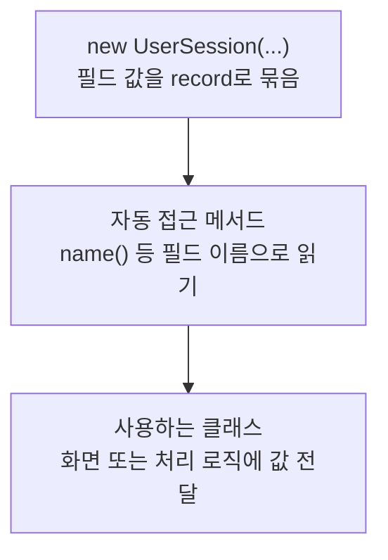

> [!info] 개발 중인 코드
> 2026-11-11 작업본 기준이다. 확정 설계가 아니며, 코드가 바뀌면 이 노트도 새 내용으로 바꿔요.

## 한눈에 보기

지금 로그인한 일반 회원이 누구인지 화면 사이에 넘기는 작은 정보 묶음이에요. 여기에는 회원 번호와 이름만 있고 비밀번호는 넣지 않아요.

- **현재 위치:** 현재 사용
- **원본:** `src/main/java/kr/ac/university/localdb/UserSession.java`
- **전체 안내:** [[전체_동작_흐름|전체_동작_흐름]] · [[목차|목차]]

memberId와 name만 가진다. 비밀번호는 넣지 않는다.

## 사용 장면과 읽는 순서

로그인 창에서 코스 화면으로 이동할 때도 어떤 회원인지 알아야 해요. UserSession을 넘기면 다음 화면이 회원 번호와 이름을 읽을 수 있어요.

1. 로그인 성공 후 `UserSession()`으로 회원 번호와 이름을 묶어요.
2. 다음 화면이 `name()` 등으로 필요한 정보를 읽어요.
3. 세션을 전달한다고 회원별 코스 저장까지 자동으로 되는 것은 아니에요. 저장·다시 불러오기는 별도 연결이 필요해요.

모르는 용어는 [[문서_읽는법|문서 읽는 법과 용어 설명]]에서 찾아볼 수 있어요.

## 동작 순서

```text
MemberRepository.Login → MembershipApp → ConditionController.setUserSession()
```

## 주요 메서드와 흐름도 호출

| 메서드 | 하는 일 |
|---|---|
| `UserSession()` | 로그인한 회원 ID와 이름을 화면 사이에 전달할 세션 데이터로 한데 묶어요. |
| `name()` | 로그인 후 전달받은 회원 이름을 읽어요. 비밀번호를 읽는 함수는 없어요. |

## 코드 읽는 법

`record`는 값을 묶는 자료형이다. 예를 들어 `객체.name()`처럼 필드 이름으로 값을 읽어요. 별도 처리 함수가 없으면 호출자가 데이터를 만들어 다음 클래스에 전달하는 흐름을 보면 된다.

## 사용한 Java 라이브러리·API

아래 표는 가져다 쓴 도구, 이 클래스에서 만나는 함수, 사용하는 이유를 연결해 보여줘요. JDK 기본은 Java에 포함된 기능이고, 별도 라이브러리는 프로젝트가 추가로 준비하는 도구예요. 처음에는 도구 이름을 외우기보다 마지막 열의 역할부터 읽어 보세요.

| 라이브러리·API | 사용 메서드/위치 | 여기서 하는 일 |
|---|---|---|
| JDK 기본 자료형·record | 생성자·자동 접근 메서드 | 별도 외부 라이브러리 없이 값이나 실행 진입점만 정의한다. 호출한 다른 클래스가 쓰는 라이브러리와 구분해요. |

외부 라이브러리 버전과 전체 사용 위치: [[라이브러리_사용_안내|라이브러리 사용 안내]]

## 클래스 내부 함수 흐름도



이 값 묶음(record)은 생성할 때 정보를 받고, Java가 제공하는 읽기 함수로 값을 꺼내요. 그림은 이 정보 전달을 보여줘요.

## 핵심 코드

원본 3행 부근의 실제 코드다.

```java
public record UserSession(long memberId, String name) {

}
```

## 변경할 때 주의할 점

현재 세션 전달은 되어 있으나 회원별 코스 저장·재조회는 후속 기능이다.
