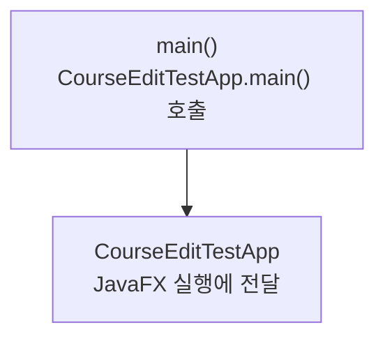

> [!info] 개발 중인 코드
> 2026-11-11 작업본 기준이다. 확정 설계가 아니며, 코드가 바뀌면 이 노트도 새 내용으로 바꿔요.

## 한눈에 보기

이전 코스 편집 화면만 따로 실행해 볼 수 있도록 시작을 연결하는 작은 파일이에요. 앱 전체를 거치지 않고 화면 모양을 확인할 때 사용해요.

- **현재 위치:** 화면 데모
- **원본:** `src/main/java/com/datecourse/demo/CourseEditLauncher.java`
- **전체 안내:** [[전체_동작_흐름|전체_동작_흐름]] · [[목차|목차]]

## 사용 장면과 읽는 순서

이전 코스 편집 화면의 배치나 버튼을 확인하고 싶을 때 이 시작 파일이 해당 CourseEditTestApp을 실행해 줘요.

1. `main()`이 `CourseEditTestApp.main()`에 실행을 넘겨요.
2. 이후 JavaFX 창 준비는 CourseEditTestApp이 담당해요. TestApp이라는 이름이지만 결과를 자동 판정하는 JUnit 검사는 아니에요.
3. 예제 코스와 총예산 30000원을 쓰는 이전 화면이에요. 현재 장소별 추천·편집 화면과 구분하세요.

모르는 용어는 [[문서_읽는법|문서 읽는 법과 용어 설명]]에서 찾아볼 수 있어요.

## 동작 순서

```text
main() → CourseEditTestApp.main() → JavaFX 실행
```

## 주요 메서드

| 메서드 | 하는 일 |
|---|---|
| `main()` | 해당 화면 테스트 앱에 실행을 넘긴다. |
| `CourseEditTestApp.main()` | JavaFX 런타임을 시작한다. |

## 사용한 Java 라이브러리·API

아래 표는 가져다 쓴 도구, 이 클래스에서 만나는 함수, 사용하는 이유를 연결해 보여줘요. JDK 기본은 Java에 포함된 기능이고, 별도 라이브러리는 프로젝트가 추가로 준비하는 도구예요. 처음에는 도구 이름을 외우기보다 마지막 열의 역할부터 읽어 보세요.

| 라이브러리·API | 사용 메서드/위치 | 여기서 하는 일 |
|---|---|---|
| JDK 기본 자료형·record | 생성자·자동 접근 메서드 | 별도 외부 라이브러리 없이 값이나 실행 진입점만 정의한다. 호출한 다른 클래스가 쓰는 라이브러리와 구분해요. |

외부 라이브러리 버전과 전체 사용 위치: [[라이브러리_사용_안내|라이브러리 사용 안내]]

## 클래스 내부 함수 흐름도



## 핵심 코드

원본 4행 부근의 실제 코드다.

```java
public static void main(String[] args) {
    CourseEditTestApp.main(args);
}
```

## 변경할 때 주의할 점

TestApp이라는 이름이지만 JUnit 자동 테스트가 아니라 수동 화면 미리보기 도구다.

## 함께 읽기

[[06_데모/CourseEditTestApp|CourseEditTestApp]]
