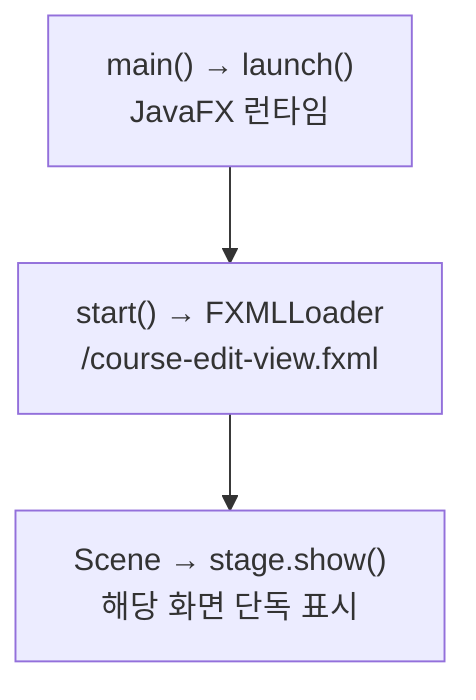

> [!info] 개발 중인 코드
> 2026-11-11 작업본 기준이다. 확정 설계가 아니며, 코드가 바뀌면 이 노트도 새 내용으로 바꿔요.

## 한눈에 보기

이전 코스 편집의 FXML 화면 파일을 읽어 별도 창에 띄우는 미리보기 도구예요. FXML은 화면의 버튼·목록·배치를 적어 둔 파일이에요.

- **현재 위치:** 화면 데모
- **원본:** `src/main/java/com/datecourse/demo/CourseEditTestApp.java`
- **전체 안내:** [[전체_동작_흐름|전체_동작_흐름]] · [[목차|목차]]

## 사용 장면과 읽는 순서

로그인부터 차례로 들어가지 않고 이전 코스 편집 화면만 띄워 눈으로 확인하는 용도예요. 예제 코스와 총예산 30000원을 쓰는 이전 화면이에요. 현재 장소별 추천·편집 화면과 구분하세요.

1. `main()`이 JavaFX를 시작하면 JavaFX가 `start()`를 호출해요.
2. `start()`가 FXML을 읽고 화면을 담을 창을 준비해요.
3. `stage.show()`에서 창을 실제로 보여줘요. 창을 보며 사람이 확인하는 도구이지 자동으로 통과·실패를 판정하는 테스트는 아니에요.

모르는 용어는 [[문서_읽는법|문서 읽는 법과 용어 설명]]에서 찾아볼 수 있어요.

## 동작 순서

```text
main() → launch() → start() → course-edit-view.fxml → Scene → Stage.show()
```

## 주요 메서드

| 메서드 | 하는 일 |
|---|---|
| `main()` | JavaFX 런타임을 시작한다. |
| `start()` | FXML을 읽고 창에 보여줘요. |
| `launch()` | JavaFX 런타임을 시작하고 Application.start()를 호출하게 한다. |
| `stage.show()` | 준비한 JavaFX 창을 화면에 보여줘요. |

## 사용한 Java 라이브러리·API

아래 표는 가져다 쓴 도구, 이 클래스에서 만나는 함수, 사용하는 이유를 연결해 보여줘요. JDK 기본은 Java에 포함된 기능이고, 별도 라이브러리는 프로젝트가 추가로 준비하는 도구예요. 처음에는 도구 이름을 외우기보다 마지막 열의 역할부터 읽어 보세요.

| 라이브러리·API | 사용 메서드/위치 | 여기서 하는 일 |
|---|---|---|
| JavaFX FXML<br/>별도 JavaFX 21: javafx.fxml<br/>FXMLLoader | start() | FXML 화면 파일을 읽고 @FXML 필드·이벤트를 컨트롤러와 연결해요. |
| JavaFX 창·애니메이션<br/>별도 JavaFX 21: javafx.graphics<br/>Application, Parent, Scene, Stage | start() | 화면/창을 만들거나 같은 창의 전환·이동·투명도 애니메이션을 실행한다. |

외부 라이브러리 버전과 전체 사용 위치: [[라이브러리_사용_안내|라이브러리 사용 안내]]

## 클래스 내부 함수 흐름도



## 핵심 코드

원본 18행 부근의 실제 코드다.

```java
public void start(Stage stage) throws Exception {
    FXMLLoader loader = new FXMLLoader(getClass().getResource("/course-edit-view.fxml"));
    Parent root = loader.load();

    // 3번 화면이 추천 코스 3개 + 예산을 넘겨주는 상황을 흉내냄
    CourseEditController controller = loader.getController();
    controller.setCourses(FakeCourseData.getSavedCourses(), 30000);

    stage.setScene(new Scene(root));
    stage.setTitle("코스 수정 테스트");
    stage.show();
}
```

## 변경할 때 주의할 점

FakeCourseData와 예산 30000원을 이전 편집 화면에 넘겨줘요. 현재 one-by-one 편집 화면과 다르다.

## 함께 읽기

[[02_화면/CourseEditController|CourseEditController]] · [[06_데모/FakeCourseData|FakeCourseData]]
