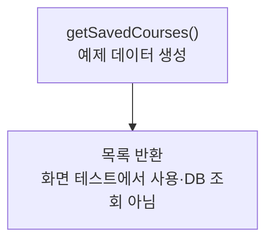

> [!info] 개발 중인 코드
> 2026-11-11 작업본 기준이다. 확정 설계가 아니며, 코드가 바뀌면 이 노트도 새 내용으로 바꿔요.

## 한눈에 보기

화면을 먼저 만들어 볼 수 있도록 코스 예시 자료를 준비하는 도구예요. 아직 실제 저장소를 연결하지 않은 화면에서도 목록과 버튼을 확인할 수 있게 해줘요.

- **현재 위치:** 예제 데이터
- **원본:** `src/main/java/com/datecourse/demo/FakeCourseData.java`
- **전체 안내:** [[전체_동작_흐름|전체_동작_흐름]] · [[목차|목차]]

## 사용 장면과 읽는 순서

목록이 비어 있으면 선택·정렬·상세 화면을 확인하기 어려우므로, 개발 중에는 예시 코스 자료를 넣어 화면 동작을 살펴봐요.

1. `getSavedCourses()`가 실행 중인 프로그램 안에 예시 목록을 만들어요.
2. 호출한 예제 화면이 그 목록을 받아 보여줘요.
3. 실제 회원이 저장한 코스를 읽지 않아요. 예전 Course·CoursePlace 형태의 예시 목록이에요.

모르는 용어는 [[문서_읽는법|문서 읽는 법과 용어 설명]]에서 찾아볼 수 있어요.

## 동작 순서

```text
getSavedCourses() → CoursePlace 예제 구성 → make()에서 가격 합계 → Course 목록
```

## 주요 메서드

| 메서드 | 하는 일 |
|---|---|
| `getSavedCourses()` | 메모리에 예제 목록을 만들어 돌려줘요. |

## 사용한 Java 라이브러리·API

아래 표는 가져다 쓴 도구, 이 클래스에서 만나는 함수, 사용하는 이유를 연결해 보여줘요. JDK 기본은 Java에 포함된 기능이고, 별도 라이브러리는 프로젝트가 추가로 준비하는 도구예요. 처음에는 도구 이름을 외우기보다 마지막 열의 역할부터 읽어 보세요.

| 라이브러리·API | 사용 메서드/위치 | 여기서 하는 일 |
|---|---|---|
| 목록·대응표<br/>JDK 기본: java.util<br/>List, ArrayList | getSavedCourses(), make() | 장소 목록·ID별 반경·정렬·중복 제거·문자열 설정을 관리한다. stream/filter/map은 목록을 고르고 변환하는 데 사용해요. |

외부 라이브러리 버전과 전체 사용 위치: [[라이브러리_사용_안내|라이브러리 사용 안내]]

## 클래스 내부 함수 흐름도



## 핵심 코드

원본 12행 부근의 일부 발췌다. 아래 코드만 따로 복사해 실행하는 예제는 아니다.

```java
public static List<Course> getSavedCourses() {
    List<Course> list = new ArrayList<>();

    list.add(make("c1", "수원 화성 산책 코스", List.of(
            new CoursePlace("p1", "할매순대국", "식사", "수원시 팔달구 1-1", 37.28, 127.01, 9000),
            new CoursePlace("p2", "모닝커피", "카페", "수원시 팔달구 2-2", 37.29, 127.02, 6000),
            new CoursePlace("p3", "화성 전시관", "문화", "수원시 팔달구 3-3", 37.29, 127.01, 10000))));

    list.add(make("c2", "파스타 데이트", List.of(
            new CoursePlace("p4", "파스타하우스", "식사", "수원시 영통구 4-4", 37.25, 127.07, 18000),
            new CoursePlace("p5", "브런치카페", "카페", "수원시 영통구 5-5", 37.26, 127.07, 9000))));

    list.add(make("c3", "영화 보는 날", List.of(
            new CoursePlace("p6", "라멘집", "식사", "수원시 장안구 6-6", 37.30, 127.00, 11000),
            new CoursePlace("p7", "시네마극장", "문화", "수원시 장안구 7-7", 37.31, 127.00, 14000),
            new CoursePlace("p8", "달빛카페", "카페", "수원시 장안구 8-8", 37.31, 127.01, 7000))));

    return list;
// ... 이후 코드는 원본 참고
```

## 변경할 때 주의할 점

실제 로그인 회원의 저장 코스가 아니다.

## 함께 읽기

[[04_데이터/Course|Course]] · [[04_데이터/CoursePlace|CoursePlace]]
