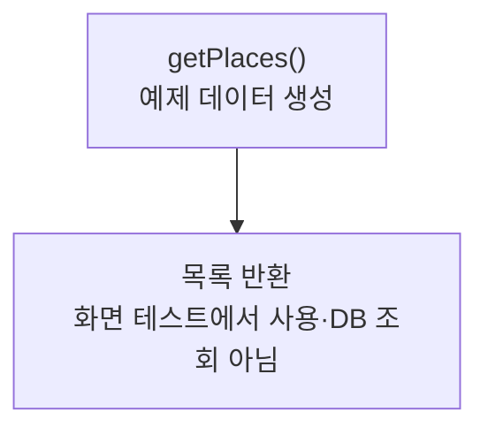

> [!info] 개발 중인 코드
> 2026-11-11 작업본 기준이다. 확정 설계가 아니며, 코드가 바뀌면 이 노트도 새 내용으로 바꿔요.

## 한눈에 보기

화면을 먼저 만들어 볼 수 있도록 지도 위치 예시 자료를 준비하는 도구예요. 아직 실제 저장소를 연결하지 않은 화면에서도 목록과 버튼을 확인할 수 있게 해줘요.

- **현재 위치:** 예제 데이터
- **원본:** `src/main/java/com/datecourse/demo/FakeMapData.java`
- **전체 안내:** [[전체_동작_흐름|전체_동작_흐름]] · [[목차|목차]]

## 사용 장면과 읽는 순서

목록이 비어 있으면 선택·정렬·상세 화면을 확인하기 어려우므로, 개발 중에는 예시 지도 위치 자료를 넣어 화면 동작을 살펴봐요.

1. `getPlaces()`가 실행 중인 프로그램 안에 예시 목록을 만들어요.
2. 호출한 예제 화면이 그 목록을 받아 보여줘요.
3. 내부 Place의 x·y는 화면상의 픽셀 위치예요. 실제 장소의 위도·경도와는 다른 값이에요.

모르는 용어는 [[문서_읽는법|문서 읽는 법과 용어 설명]]에서 찾아볼 수 있어요.

## 동작 순서

```text
getPlaces() → 이름·분류·픽셀 좌표·가격을 가진 내부 Place 목록
```

## 주요 메서드

| 메서드 | 하는 일 |
|---|---|
| `getPlaces()` | 메모리에 예제 목록을 만들어 돌려줘요. |

## 사용한 Java 라이브러리·API

아래 표는 가져다 쓴 도구, 이 클래스에서 만나는 함수, 사용하는 이유를 연결해 보여줘요. JDK 기본은 Java에 포함된 기능이고, 별도 라이브러리는 프로젝트가 추가로 준비하는 도구예요. 처음에는 도구 이름을 외우기보다 마지막 열의 역할부터 읽어 보세요.

| 라이브러리·API | 사용 메서드/위치 | 여기서 하는 일 |
|---|---|---|
| 목록·대응표<br/>JDK 기본: java.util<br/>List | getPlaces() | 장소 목록·ID별 반경·정렬·중복 제거·문자열 설정을 관리한다. stream/filter/map은 목록을 고르고 변환하는 데 사용해요. |

외부 라이브러리 버전과 전체 사용 위치: [[라이브러리_사용_안내|라이브러리 사용 안내]]

## 클래스 내부 함수 흐름도



이 값 묶음(record)은 생성할 때 정보를 받고, Java가 제공하는 읽기 함수로 값을 꺼내요. 그림은 이 정보 전달을 보여줘요.

## 핵심 코드

원본 11행 부근의 실제 코드다.

```java
public static List<Place> getPlaces() {
    return List.of(
            new Place("할매순대국", "식사", 100, 80, 9000),
            new Place("파스타하우스", "식사", 180, 150, 18000),
            new Place("스시로", "식사", 260, 100, 25000),
            new Place("홍콩반점", "식사", 340, 190, 12000),
            new Place("모닝커피", "카페", 220, 230, 6000),
            new Place("달빛포차", "식사", 420, 120, 20000),
            new Place("시네마극장", "문화", 300, 300, 14000),
            new Place("브런치카페", "카페", 120, 260, 9000),
            new Place("고깃집 불꽃", "식사", 460, 280, 22000),
            new Place("이탈리안 바", "식사", 400, 350, 30000),
            new Place("라멘집", "식사", 70, 350, 11000),
            new Place("전시관", "문화", 500, 60, 10000)
    );
}
```

## 변경할 때 주의할 점

내부 FakeMapData.Place의 x/y는 픽셀 좌표다. 실제 model.Place의 위도·경도와 다르다.

## 함께 읽기

[[04_데이터/Place|Place]]

## 이 파일 안의 내부 타입

| 내부 타입 | 역할 |
|---|---|
| `Place` | 실제 위경도가 아닌 가짜 지도 x/y 픽셀 좌표와 표시 정보를 한데 묶어요. |
