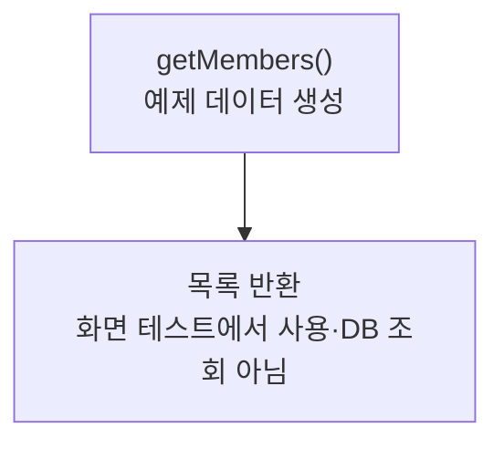

> [!info] 개발 중인 코드
> 2026-11-11 작업본 기준이다. 확정 설계가 아니며, 코드가 바뀌면 이 노트도 새 내용으로 바꿔요.

## 한눈에 보기

화면을 먼저 만들어 볼 수 있도록 회원 예시 자료를 준비하는 도구예요. 아직 실제 저장소를 연결하지 않은 화면에서도 목록과 버튼을 확인할 수 있게 해줘요.

- **현재 위치:** 예제 데이터
- **원본:** `src/main/java/com/datecourse/demo/FakeMemberData.java`
- **전체 안내:** [[전체_동작_흐름|전체_동작_흐름]] · [[목차|목차]]

## 사용 장면과 읽는 순서

목록이 비어 있으면 선택·정렬·상세 화면을 확인하기 어려우므로, 개발 중에는 예시 회원 자료를 넣어 화면 동작을 살펴봐요.

1. `getMembers()`가 실행 중인 프로그램 안에 예시 목록을 만들어요.
2. 호출한 예제 화면이 그 목록을 받아 보여줘요.
3. 실제 members 테이블을 읽지 않아요. 관리자 화면 모양을 확인하기 위한 예시 회원들이에요.

모르는 용어는 [[문서_읽는법|문서 읽는 법과 용어 설명]]에서 찾아볼 수 있어요.

## 동작 순서

```text
getMembers() → USER/ADMIN·정지 여부가 다른 Member 목록
```

## 주요 메서드

| 메서드 | 하는 일 |
|---|---|
| `getMembers()` | 메모리에 예제 목록을 만들어 돌려줘요. |

## 사용한 Java 라이브러리·API

아래 표는 가져다 쓴 도구, 이 클래스에서 만나는 함수, 사용하는 이유를 연결해 보여줘요. JDK 기본은 Java에 포함된 기능이고, 별도 라이브러리는 프로젝트가 추가로 준비하는 도구예요. 처음에는 도구 이름을 외우기보다 마지막 열의 역할부터 읽어 보세요.

| 라이브러리·API | 사용 메서드/위치 | 여기서 하는 일 |
|---|---|---|
| 목록·대응표<br/>JDK 기본: java.util<br/>List, ArrayList | getMembers() | 장소 목록·ID별 반경·정렬·중복 제거·문자열 설정을 관리한다. stream/filter/map은 목록을 고르고 변환하는 데 사용해요. |
| 날짜<br/>JDK 기본: java.time<br/>LocalDate | getMembers() | 예제 코스·리뷰 날짜와 기본 코스 이름의 날짜를 만들어요. |

외부 라이브러리 버전과 전체 사용 위치: [[라이브러리_사용_안내|라이브러리 사용 안내]]

## 클래스 내부 함수 흐름도



## 핵심 코드

원본 12행 부근의 실제 코드다.

```java
public static List<Member> getMembers() {
    List<Member> list = new ArrayList<>();
    list.add(new Member("m1", "민지", "USER", LocalDate.of(2026, 9, 1), false));
    list.add(new Member("m2", "준호", "USER", LocalDate.of(2026, 9, 3), false));
    list.add(new Member("m3", "서연", "USER", LocalDate.of(2026, 9, 10), false));
    list.add(new Member("m4", "하늘", "USER", LocalDate.of(2026, 9, 15), false));
    list.add(new Member("m5", "도윤", "USER", LocalDate.of(2026, 9, 20), true));
    list.add(new Member("m0", "관리자", "ADMIN", LocalDate.of(2026, 8, 20), false));
    return list;
}
```

## 변경할 때 주의할 점

실제 members 테이블을 읽지 않는다.

## 함께 읽기

[[04_데이터/Member|Member]]
