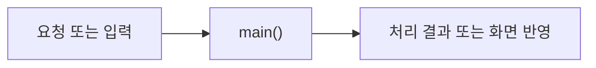

# PlaceBindingDemo

> 개발 중인 코드예요. `ea2242b` 기준이며, 후속 커밋에서 동작이 바뀔 수 있어요.

## 한눈에 보기

실제 API 호출 없이 검증된 장소 ID 연결표를 확인해요.

## 코드 읽기

아래 선언부터 읽고 함수표의 순서로 찾아보세요. 전체 코드는 [기준 커밋의 원본](https://github.com/2egn/DateCourseApp/blob/ea2242b/src/main/java/com/datecourse/demo/PlaceBindingDemo.java)에서 확인해요.

```java
public final class PlaceBindingDemo {
```

## 주요 함수

| 함수 | 하는 일 |
|---|---|
| `main()` | 연결표 확인 결과를 출력해요. |

## 동작 흐름

사용자 요청 또는 다른 클래스의 호출로 시작해요. 자세한 분기는 위 함수표와 원본 코드를 함께 봐요.



관련 안내: [[현재_구현_흐름|현재 전체 흐름]] · [[업데이트_내역|이번 변경]]
