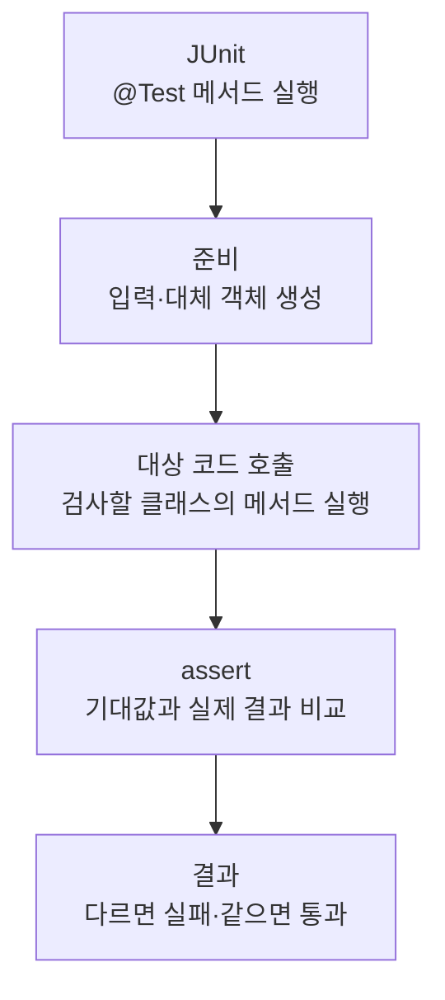

> [!info] 개발 중인 코드
> 2026-11-11 작업본 기준이다. 확정 설계가 아니며, 코드가 바뀌면 이 노트도 새 내용으로 바꿔요.

## 한눈에 보기

DB 연결을 다시 쓰고 로그인 실패 뒤에도 사용할 수 있는지 자동으로 확인하는 검사예요.

- **현재 위치:** 자동 테스트
- **원본:** `src/test/java/kr/ac/university/localdb/db/DatabasePoolTest.java`
- **전체 안내:** [[전체_동작_흐름|전체_동작_흐름]] · [[목차|목차]]

연결 재사용·교체·종료, 로그인 실패 후 재사용, 없는 회원·비활성 회원 거부를 확인해요.

## 사용 장면과 읽는 순서

비밀번호를 한 번 틀렸다고 연결 풀이 고장 나면 다음 로그인도 실패할 수 있어요. 이런 상황과 연결 교체·종료를 확인해요.

1. 테스트가 필요한 입력과 시험용 환경을 먼저 준비해요. 실제 서비스 대신 예상한 응답을 주는 대체 코드를 쓰는 경우도 있어요.
2. 확인하려는 클래스의 함수를 호출하고 결과를 받아요.
3. assertEquals·assertTrue 같은 확인 문장으로 예상 결과와 실제 결과를 비교해요. 각각의 테스트 함수는 독립적인 검사예요.
4. 실제 운영 MySQL 대신 H2라는 시험용 DB를 사용해요. 운영 DB의 접속 설정이나 실제 장소 자료가 맞는지는 별도로 확인해야 해요.

모르는 용어는 [[문서_읽는법|문서 읽는 법과 용어 설명]]에서 찾아볼 수 있어요.

## 동작 순서

```text
JUnit이 @Test 메서드 실행 → 테스트용 입력/대체 객체 준비 → 대상 코드 호출 → assert로 기대 결과 확인
```

## 주요 메서드

| 메서드 | 하는 일 |
|---|---|
| `initializationConnectionIsReusedAndPoolShutsDown()` | 초기 연결을 재사용하고 풀을 정상 종료하는지 확인해요. |
| `retiredConnectionIsReplaced()` | 수명이 끝난 연결이 새 연결로 교체되는지 확인해요. |
| `loginCanReusePoolAfterAnAuthenticationFailure()` | 인증 실패 후에도 같은 풀로 다시 로그인할 수 있는지 확인해요. |
| `unknownMemberIsRejected()` | 없는 회원의 로그인을 거부하는지 확인해요. |

## 사용한 Java 라이브러리·API

아래 표는 가져다 쓴 도구, 이 클래스에서 만나는 함수, 사용하는 이유를 연결해 보여줘요. JDK 기본은 Java에 포함된 기능이고, 별도 라이브러리는 프로젝트가 추가로 준비하는 도구예요. 처음에는 도구 이름을 외우기보다 마지막 열의 역할부터 읽어 보세요.

| 라이브러리·API | 사용 메서드/위치 | 여기서 하는 일 |
|---|---|---|
| 목록·대응표<br/>JDK 기본: java.util<br/>UUID | createPool() | 장소 목록·ID별 반경·정렬·중복 제거·문자열 설정을 관리한다. stream/filter/map은 목록을 고르고 변환하는 데 사용해요. |
| DB JDBC<br/>JDK 기본: java.sql / javax.sql<br/>Connection, Statement, PreparedStatement, SQLException | initializationConnectionIsReusedAndPoolShutsDown(), retiredConnectionIsReplaced(), prepareMember() | DB 연결을 빌리고 매개변수가 있는 SQL을 실행해 행을 읽거나 변경한다. try (...)로 사용 자원을 닫는다. |
| HikariCP 연결 풀<br/>외부: HikariCP 7.1.0<br/>HikariDataSource | createPool(), closePool(), initializationConnectionIsReusedAndPoolShutsDown(), retiredConnectionIsReplaced(), loginCanReusePoolAfterAnAuthenticationFailure(), unknownMemberIsRejected() 외 2개 | DB 연결을 재사용해요. DatabasePool.create()에서 만들고 저장소가 getConnection()으로 빌려 쓴다. |
| JUnit 자동 검사<br/>외부: JUnit Jupiter 5.10.0<br/>Test, BeforeAll, BeforeEach, AfterEach, Assertions, assertEquals/assertTrue 등 | hashPassword(), createPool(), closePool(), initializationConnectionIsReusedAndPoolShutsDown(), retiredConnectionIsReplaced(), loginCanReusePoolAfterAnAuthenticationFailure() 외 3개 | @Test로 검사 메서드를 지정하고 assertEquals/assertTrue 등으로 기대값을 확인해요. |
| H2 2.3.232<br/>(테스트 전용 DB) | 테스트 DB 생성·SQL 실행 메서드 | 운영 DB 대신 로컬 메모리 DB에서 SQL과 트랜잭션을 확인해요. |

외부 라이브러리 버전과 전체 사용 위치: [[라이브러리_사용_안내|라이브러리 사용 안내]]

## 클래스 내부 함수 흐름도



개별 테스트는 각각 독립적으로 이 순서를 따른다. @Test 메서드끼리 순서대로 호출하는 구조는 아니다.

## 핵심 코드

원본 33행 부근의 실제 코드다.

```java
void initializationConnectionIsReusedAndPoolShutsDown() throws Exception {
    assertNull(pool.getHikariPoolMXBean(), "Creating the repository must not connect on the UI thread");
    Connection physical;
    try (Connection first = pool.getConnection()) {
        physical = first.unwrap(JdbcConnection.class);
    }
    assertFalse(physical.isClosed(), "Returning a connection must not disconnect from the database");
    try (Connection next = pool.getConnection()) {
        assertSame(physical, next.unwrap(JdbcConnection.class));
    }
    pool.close();
    assertTrue(physical.isClosed());
    assertThrows(SQLException.class, () -> pool.getConnection());
}
```

## 변경할 때 주의할 점

H2 테스트 DB를 사용해요. 운영 MySQL 연결과 데이터 일치까지 보장하지 않는다.

## 함께 읽기

[[05_회원_DB/DatabasePool|DatabasePool]] · [[05_회원_DB/DbSettings|DbSettings]] · [[05_회원_DB/MemberRepository|MemberRepository]] · [[05_회원_DB/PasswordHash|PasswordHash]]

## 나머지 검사 항목

메서드 이름은 원본 그대로 적었다. 세부 입력과 기대값은 해당 메서드의 `assert`를 확인해요.

- `inactiveMemberIsRejected()`
