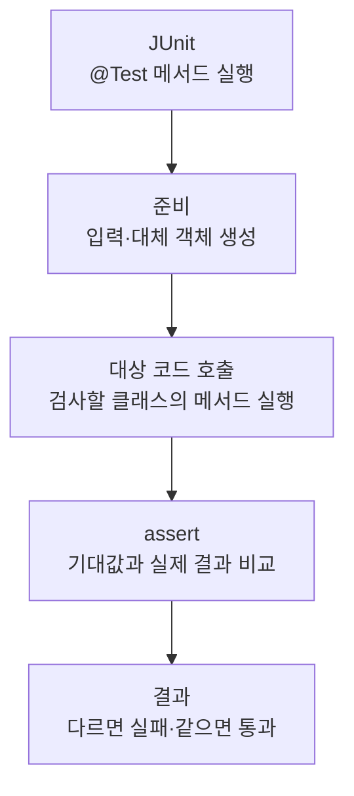

> [!info] 개발 중인 코드
> 2026-11-11 작업본 기준이다. 확정 설계가 아니며, 코드가 바뀌면 이 노트도 새 내용으로 바꿔요.

## 한눈에 보기

DB 접속 설정을 어느 곳에서 읽고 어떤 값을 우선하는지 확인하는 검사예요.

- **현재 위치:** 자동 테스트
- **원본:** `src/test/java/kr/ac/university/localdb/db/DbSettingsTest.java`
- **전체 안내:** [[전체_동작_흐름|전체_동작_흐름]] · [[목차|목차]]

환경변수 우선, 빈 환경변수 fallback, 비밀번호 공백 보존과 누락 예외를 확인해요.

## 사용 장면과 읽는 순서

환경변수가 비었으면 파일 값을 쓰되, 비밀번호에 들어 있는 공백은 마음대로 지우면 안 돼요. 필수 설정이 없는 경우도 확인해요.

1. 테스트가 필요한 입력과 시험용 환경을 먼저 준비해요. 실제 서비스 대신 예상한 응답을 주는 대체 코드를 쓰는 경우도 있어요.
2. 확인하려는 클래스의 함수를 호출하고 결과를 받아요.
3. assertEquals·assertTrue 같은 확인 문장으로 예상 결과와 실제 결과를 비교해요. 각각의 테스트 함수는 독립적인 검사예요.
4. 실제 DB에 접속해 성공하는지보다 설정값을 읽는 규칙을 검사해요.

모르는 용어는 [[문서_읽는법|문서 읽는 법과 용어 설명]]에서 찾아볼 수 있어요.

## 동작 순서

```text
JUnit이 @Test 메서드 실행 → 테스트용 입력/대체 객체 준비 → 대상 코드 호출 → assert로 기대 결과 확인
```

## 주요 메서드

| 메서드 | 하는 일 |
|---|---|
| `readsConfiguredUrlUserAndExactPassword()` | URL·사용자·비밀번호를 원래 값대로 읽는지 확인해요. |
| `missingSettingsNeverFallBackToLocalhost()` | 설정 누락 시 임의의 localhost로 접속하지 않는지 확인해요. |
| `explicitEnvironmentOverridesArePreserved()` | 환경변수가 파일 설정보다 우선하는지 확인해요. |
| `blankEnvironmentValuesUseProperties()` | 빈 환경변수는 파일 값으로 대체되는지 확인해요. |

## 사용한 Java 라이브러리·API

아래 표는 가져다 쓴 도구, 이 클래스에서 만나는 함수, 사용하는 이유를 연결해 보여줘요. JDK 기본은 Java에 포함된 기능이고, 별도 라이브러리는 프로젝트가 추가로 준비하는 도구예요. 처음에는 도구 이름을 외우기보다 마지막 열의 역할부터 읽어 보세요.

| 라이브러리·API | 사용 메서드/위치 | 여기서 하는 일 |
|---|---|---|
| 목록·대응표<br/>JDK 기본: java.util<br/>Map, Properties | configured(), readsConfiguredUrlUserAndExactPassword(), missingSettingsNeverFallBackToLocalhost(), explicitEnvironmentOverridesArePreserved(), blankEnvironmentValuesUseProperties() | 장소 목록·ID별 반경·정렬·중복 제거·문자열 설정을 관리한다. stream/filter/map은 목록을 고르고 변환하는 데 사용해요. |
| JUnit 자동 검사<br/>외부: JUnit Jupiter 5.10.0<br/>Test, Assertions, assertEquals/assertTrue 등 | readsConfiguredUrlUserAndExactPassword(), missingSettingsNeverFallBackToLocalhost(), explicitEnvironmentOverridesArePreserved(), blankEnvironmentValuesUseProperties() | @Test로 검사 메서드를 지정하고 assertEquals/assertTrue 등으로 기대값을 확인해요. |

외부 라이브러리 버전과 전체 사용 위치: [[라이브러리_사용_안내|라이브러리 사용 안내]]

## 클래스 내부 함수 흐름도



개별 테스트는 각각 독립적으로 이 순서를 따른다. @Test 메서드끼리 순서대로 호출하는 구조는 아니다.

## 핵심 코드

원본 18행 부근의 실제 코드다.

```java
void readsConfiguredUrlUserAndExactPassword() {
    Properties properties = configured();
    DbSettings settings = DbSettings.from(properties, Map.of());
    assertEquals(properties.getProperty("db.url"), settings.url());
    assertEquals(properties.getProperty("db.user"), settings.user());
    assertEquals(properties.getProperty("db.password"), settings.password());
}
```

## 변경할 때 주의할 점

테스트용 설정이며 실제 접속 비밀번호는 문서에 포함하지 않는다.

## 함께 읽기

[[05_회원_DB/DbSettings|DbSettings]]
