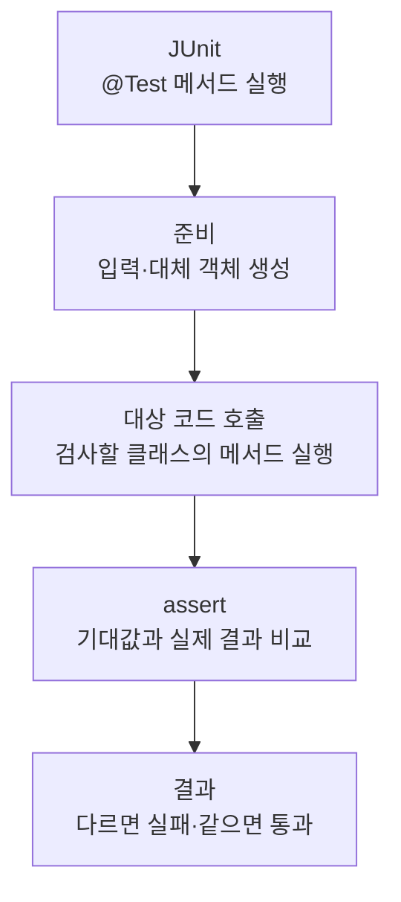

> [!info] 개발 중인 코드
> 2026-11-11 작업본 기준이다. 확정 설계가 아니며, 코드가 바뀌면 이 노트도 새 내용으로 바꿔요.

## 한눈에 보기

지도에서 Java로 넘어오는 위치·장소·링크·준비 알림을 확인하는 검사예요.

- **현재 위치:** 자동 테스트
- **원본:** `src/test/java/com/datecourse/controller/MapBridgeTest.java`
- **전체 안내:** [[전체_동작_흐름|전체_동작_흐름]] · [[목차|목차]]

위도·경도 순서와 범위, 준비·오류 알림, 허용/거부 외부 URL을 확인해요.

## 사용 장면과 읽는 순서

위도와 경도가 뒤집히거나 허용되지 않은 링크가 넘어오면 다른 장소를 고르거나 잘못된 페이지를 열 수 있어요.

1. 테스트가 필요한 입력과 시험용 환경을 먼저 준비해요. 실제 서비스 대신 예상한 응답을 주는 대체 코드를 쓰는 경우도 있어요.
2. 확인하려는 클래스의 함수를 호출하고 결과를 받아요.
3. assertEquals·assertTrue 같은 확인 문장으로 예상 결과와 실제 결과를 비교해요. 각각의 테스트 함수는 독립적인 검사예요.
4. 입력을 받아 넘기는 경계를 검사하며 실제 브라우저 창은 열지 않아요.

모르는 용어는 [[문서_읽는법|문서 읽는 법과 용어 설명]]에서 찾아볼 수 있어요.

## 동작 순서

```text
JUnit이 @Test 메서드 실행 → 테스트용 입력/대체 객체 준비 → 대상 코드 호출 → assert로 기대 결과 확인
```

## 주요 메서드

| 메서드 | 하는 일 |
|---|---|
| `coordinatesKeepLatitudeLongitudeOrder()` | 위도와 경도의 순서가 뒤바뀌지 않는지 확인해요. |
| `rejectsNonFiniteAndOutOfRangeCoordinates()` | 유한하지 않거나 범위를 벗어난 좌표를 거부하는지 확인해요. |
| `forwardsReadyAndFailureNotifications()` | 지도 준비·오류 이벤트가 콜백에 전달되는지 확인해요. |
| `onlyKakaoWebLinksAreForwardedToExternalBrowser()` | 허용된 Kakao 계열 웹 주소만 외부로 전달하는지 확인해요. |

## 사용한 Java 라이브러리·API

아래 표는 가져다 쓴 도구, 이 클래스에서 만나는 함수, 사용하는 이유를 연결해 보여줘요. JDK 기본은 Java에 포함된 기능이고, 별도 라이브러리는 프로젝트가 추가로 준비하는 도구예요. 처음에는 도구 이름을 외우기보다 마지막 열의 역할부터 읽어 보세요.

| 라이브러리·API | 사용 메서드/위치 | 여기서 하는 일 |
|---|---|---|
| 비동기·콜백<br/>JDK 기본: java.lang / java.util.concurrent / java.util.function<br/>AtomicReference, AtomicInteger | coordinatesKeepLatitudeLongitudeOrder(), rejectsNonFiniteAndOutOfRangeCoordinates(), forwardsReadyAndFailureNotifications(), onlyKakaoWebLinksAreForwardedToExternalBrowser() | 오래 걸리는 작업을 분리하고 완료 동작을 넘겨줘요. 테스트에서는 작업 완료를 기다리거나 결과를 보관해요. |
| JUnit 자동 검사<br/>외부: JUnit Jupiter 5.10.0<br/>Test, Assertions, assertEquals/assertTrue 등 | coordinatesKeepLatitudeLongitudeOrder(), rejectsNonFiniteAndOutOfRangeCoordinates(), forwardsReadyAndFailureNotifications(), onlyKakaoWebLinksAreForwardedToExternalBrowser() | @Test로 검사 메서드를 지정하고 assertEquals/assertTrue 등으로 기대값을 확인해요. |

외부 라이브러리 버전과 전체 사용 위치: [[라이브러리_사용_안내|라이브러리 사용 안내]]

## 클래스 내부 함수 흐름도



개별 테스트는 각각 독립적으로 이 순서를 따른다. @Test 메서드끼리 순서대로 호출하는 구조는 아니다.

## 핵심 코드

원본 10행 부근의 실제 코드다.

```java
void coordinatesKeepLatitudeLongitudeOrder() {
    AtomicReference<double[]> position = new AtomicReference<>();
    MapBridge bridge = new MapBridge(() -> {}, (lat, lng) -> position.set(new double[]{lat, lng}), error -> {});
    bridge.onLocationSelected(37.5665, 126.9780);
    assertArrayEquals(new double[]{37.5665, 126.9780}, position.get());
}
```

## 변경할 때 주의할 점

MapBridge의 입력 경계를 검사하며 실제 외부 브라우저는 열지 않는다.

## 함께 읽기

[[02_화면/MapBridge|MapBridge]]
