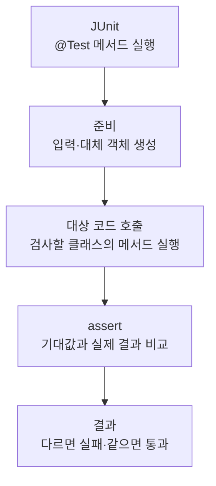

> [!info] 개발 중인 코드
> 2026-11-11 작업본 기준이다. 확정 설계가 아니며, 코드가 바뀌면 이 노트도 새 내용으로 바꿔요.

## 한눈에 보기

다음 장소 후보가 거리·가격·중복 규칙을 지키는지 확인하는 검사예요.

- **현재 위치:** 자동 테스트
- **원본:** `src/test/java/com/datecourse/service/NextPlaceServiceTest.java`
- **전체 안내:** [[전체_동작_흐름|전체_동작_흐름]] · [[목차|목차]]

두 반경 교집합, 첫 장소 중심, 가격, 중복 제외와 최대 5개를 확인해요.

## 사용 장면과 읽는 순서

출발지 전체 범위 안이면서 이전 장소와도 가까운 후보만 남는지, 기존 장소를 제외하고 최대 5곳을 돌려주는지 확인해요.

1. 테스트가 필요한 입력과 시험용 환경을 먼저 준비해요. 실제 서비스 대신 예상한 응답을 주는 대체 코드를 쓰는 경우도 있어요.
2. 확인하려는 클래스의 함수를 호출하고 결과를 받아요.
3. assertEquals·assertTrue 같은 확인 문장으로 예상 결과와 실제 결과를 비교해요. 각각의 테스트 함수는 독립적인 검사예요.
4. 추천 규칙의 정확성을 검사해요. 사용자가 그 장소를 마음에 들어 하는지까지 평가하는 검사는 아니에요.

모르는 용어는 [[문서_읽는법|문서 읽는 법과 용어 설명]]에서 찾아볼 수 있어요.

## 동작 순서

```text
JUnit이 @Test 메서드 실행 → 테스트용 입력/대체 객체 준비 → 대상 코드 호출 → assert로 기대 결과 확인
```

## 주요 메서드

| 메서드 | 하는 일 |
|---|---|
| `usesLastConfirmedPlaceAndExcludesDuplicateIdentityAndLocation()` | 이전 장소 중심 검색과 ID·이름/좌표 중복 제외를 확인해요. |
| `appliesPerPersonCapWithoutTotalBudgetLimit()` | 총예산 없이 1인 가격 상한만 적용하는지 확인해요. |
| `onlyIntersectionOfGlobalAndPreviousPlaceRangesIsEligible()` | 전체/이전 장소 두 범위의 교집합만 후보인지 확인해요. |
| `firstPlaceUsesDepartureForBothRangesAndHonorsSmallerRadius()` | 첫 장소는 출발지를 기준으로 두 반경을 검사하는지 확인해요. |

## 사용한 Java 라이브러리·API

아래 표는 가져다 쓴 도구, 이 클래스에서 만나는 함수, 사용하는 이유를 연결해 보여줘요. JDK 기본은 Java에 포함된 기능이고, 별도 라이브러리는 프로젝트가 추가로 준비하는 도구예요. 처음에는 도구 이름을 외우기보다 마지막 열의 역할부터 읽어 보세요.

| 라이브러리·API | 사용 메서드/위치 | 여기서 하는 일 |
|---|---|---|
| 목록·대응표<br/>JDK 기본: java.util<br/>List, ArrayList | usesLastConfirmedPlaceAndExcludesDuplicateIdentityAndLocation(), appliesPerPersonCapWithoutTotalBudgetLimit(), onlyIntersectionOfGlobalAndPreviousPlaceRangesIsEligible(), firstPlaceUsesDepartureForBothRangesAndHonorsSmallerRadius(), snapshotDoesNotShareMutableListAndKeepsUnitPrices(), returnsFiveNearestEligibleCandidatesAfterPriceAndDuplicateFiltering() | 장소 목록·ID별 반경·정렬·중복 제거·문자열 설정을 관리한다. stream/filter/map은 목록을 고르고 변환하는 데 사용해요. |
| JUnit 자동 검사<br/>외부: JUnit Jupiter 5.10.0<br/>Test, Assertions, assertEquals/assertTrue 등 | usesLastConfirmedPlaceAndExcludesDuplicateIdentityAndLocation(), appliesPerPersonCapWithoutTotalBudgetLimit(), onlyIntersectionOfGlobalAndPreviousPlaceRangesIsEligible(), firstPlaceUsesDepartureForBothRangesAndHonorsSmallerRadius(), snapshotDoesNotShareMutableListAndKeepsUnitPrices(), returnsFiveNearestEligibleCandidatesAfterPriceAndDuplicateFiltering() | @Test로 검사 메서드를 지정하고 assertEquals/assertTrue 등으로 기대값을 확인해요. |

외부 라이브러리 버전과 전체 사용 위치: [[라이브러리_사용_안내|라이브러리 사용 안내]]

## 클래스 내부 함수 흐름도



개별 테스트는 각각 독립적으로 이 순서를 따른다. @Test 메서드끼리 순서대로 호출하는 구조는 아니다.

## 핵심 코드

원본 16행 부근의 실제 코드다.

```java
@Test void usesLastConfirmedPlaceAndExcludesDuplicateIdentityAndLocation() {
    Place last = place(1, "선택한 카페", 35.173, 5000);
    Place duplicate = place(2, "선택한 카페", 35.173, 4000);
    Place next = place(3, "다음 카페", 35.174, 4000);
    Place nearOrigin = place(4, "출발지 근처", 35.157, 4000);
    Place outside = place(5, "전체 범위 밖", 35.176, 1000);
    var result = service.candidates(List.of(last, duplicate, next, nearOrigin, outside), List.of(last),
            35.157, 129.06, 500, "카페", 10000, 2, 2000);
    assertEquals(List.of(next), result.stream().map(PlaceSearchService.NearbyPlace::place).toList());
}
```

## 변경할 때 주의할 점

후보 선택의 정확성을 검사하며 사용자의 취향 만족도는 평가하지 않는다.

## 함께 읽기

[[03_처리/NextPlaceService|NextPlaceService]] · [[04_데이터/Place|Place]] · [[03_처리/PlaceSearchService|PlaceSearchService]] · [[04_데이터/RoutePlan|RoutePlan]]

## 나머지 검사 항목

메서드 이름은 원본 그대로 적었다. 세부 입력과 기대값은 해당 메서드의 `assert`를 확인해요.

- `snapshotDoesNotShareMutableListAndKeepsUnitPrices()`
- `returnsFiveNearestEligibleCandidatesAfterPriceAndDuplicateFiltering()`
