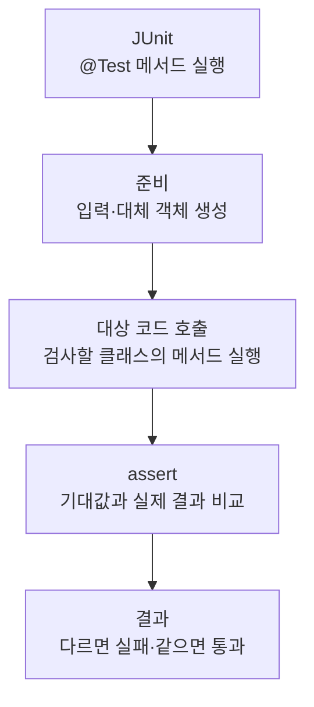

> [!info] 개발 중인 코드
> 2026-11-11 작업본 기준이다. 확정 설계가 아니며, 코드가 바뀌면 이 노트도 새 내용으로 바꿔요.

## 한눈에 보기

비밀번호 입력칸의 보기·숨기기 버튼이 올바르게 움직이는지 확인하는 검사예요.

- **현재 위치:** 자동 테스트
- **원본:** `src/test/java/kr/ac/university/localdb/ui/PasswordFieldTest.java`
- **전체 안내:** [[전체_동작_흐름|전체_동작_흐름]] · [[목차|목차]]

보기/숨기기, 값 삭제 시 숨김 복귀, 배치와 접근성 등 실제 테스트 메서드를 확인해요.

## 사용 장면과 읽는 순서

보기 버튼을 눌러도 입력한 글자와 커서가 바뀌면 안 되고, 값을 지우면 다시 가려진 상태로 돌아가야 해요.

1. 테스트가 필요한 입력과 시험용 환경을 먼저 준비해요. 실제 서비스 대신 예상한 응답을 주는 대체 코드를 쓰는 경우도 있어요.
2. 확인하려는 클래스의 함수를 호출하고 결과를 받아요.
3. assertEquals·assertTrue 같은 확인 문장으로 예상 결과와 실제 결과를 비교해요. 각각의 테스트 함수는 독립적인 검사예요.
4. 비밀번호 해시나 로그인 성공 여부가 아니라 UiTheme.PasswordField라는 화면 부품을 확인해요.

모르는 용어는 [[문서_읽는법|문서 읽는 법과 용어 설명]]에서 찾아볼 수 있어요.

## 동작 순서

```text
JUnit이 @Test 메서드 실행 → 테스트용 입력/대체 객체 준비 → 대상 코드 호출 → assert로 기대 결과 확인
```

## 주요 메서드

| 메서드 | 하는 일 |
|---|---|
| `visibilityTogglePreservesInputCaretAndEnterActionAndResetsOnClear()` | 보기 전환 시 값·커서·Enter 동작을 유지하고 값 삭제 시 다시 숨기는지 확인해요. |
| `buttonFitsInsideFieldAndFollowsDisabledState()` | 보기 버튼이 입력란 안에 들어가고 비활성 상태를 따르는지 확인해요. |
| `rendersMaskedAndVisibleEyeButtons()` | 숨김/보기 상태의 눈 모양 표시를 확인해요. |

## 사용한 Java 라이브러리·API

아래 표는 가져다 쓴 도구, 이 클래스에서 만나는 함수, 사용하는 이유를 연결해 보여줘요. JDK 기본은 Java에 포함된 기능이고, 별도 라이브러리는 프로젝트가 추가로 준비하는 도구예요. 처음에는 도구 이름을 외우기보다 마지막 열의 역할부터 읽어 보세요.

| 라이브러리·API | 사용 메서드/위치 | 여기서 하는 일 |
|---|---|---|
| Swing·AWT UI<br/>JDK 기본: java.desktop<br/>SwingUtilities, JPanel, JToggleButton, GridLayout, Color, Graphics2D | visibilityTogglePreservesInputCaretAndEnterActionAndResetsOnClear(), buttonFitsInsideFieldAndFollowsDisabledState(), rendersMaskedAndVisibleEyeButtons() | 로그인/가입 UI를 만들고 그리며 EDT에서 화면을 새 내용으로 바꿔요. Desktop은 기본 브라우저 열기에도 쓰인다. |
| 목록·대응표<br/>JDK 기본: java.util<br/>Arrays | visibilityTogglePreservesInputCaretAndEnterActionAndResetsOnClear() | 장소 목록·ID별 반경·정렬·중복 제거·문자열 설정을 관리한다. stream/filter/map은 목록을 고르고 변환하는 데 사용해요. |
| 파일·문자 입출력<br/>JDK 기본: java.io / java.nio<br/>Files, Path, IOException, ImageIO | rendersMaskedAndVisibleEyeButtons() | 설정·아이디 기록·SQL 파일을 읽거나 저장해요. 테스트에서는 화면 이미지를 파일로 남긴다. |
| 비동기·콜백<br/>JDK 기본: java.lang / java.util.concurrent / java.util.function<br/>AtomicInteger | visibilityTogglePreservesInputCaretAndEnterActionAndResetsOnClear() | 오래 걸리는 작업을 분리하고 완료 동작을 넘겨줘요. 테스트에서는 작업 완료를 기다리거나 결과를 보관해요. |
| JUnit 자동 검사<br/>외부: JUnit Jupiter 5.10.0<br/>Test, Assertions, assertEquals/assertTrue 등 | visibilityTogglePreservesInputCaretAndEnterActionAndResetsOnClear(), buttonFitsInsideFieldAndFollowsDisabledState(), rendersMaskedAndVisibleEyeButtons() | @Test로 검사 메서드를 지정하고 assertEquals/assertTrue 등으로 기대값을 확인해요. |

외부 라이브러리 버전과 전체 사용 위치: [[라이브러리_사용_안내|라이브러리 사용 안내]]

## 클래스 내부 함수 흐름도



개별 테스트는 각각 독립적으로 이 순서를 따른다. @Test 메서드끼리 순서대로 호출하는 구조는 아니다.

## 핵심 코드

원본 14행 부근의 일부 발췌다. 아래 코드만 따로 복사해 실행하는 예제는 아니다.

```java
@Test void visibilityTogglePreservesInputCaretAndEnterActionAndResetsOnClear() throws Exception {
    SwingUtilities.invokeAndWait(() -> {
        UiTheme.PasswordField field = new UiTheme.PasswordField(24);
        JToggleButton button = (JToggleButton) field.getComponent(0);
        field.setText("sample-pass-123");
        field.setCaretPosition(4);
        char[] expected = field.getPassword();
        try {
            assertTrue(field.echoCharIsSet());
            button.doClick(0);
            assertFalse(field.echoCharIsSet());
            assertEquals(4, field.getCaretPosition());
            char[] actual = field.getPassword();
            try { assertArrayEquals(expected, actual); } finally { Arrays.fill(actual, '\0'); }
            assertEquals("비밀번호 숨기기", button.getAccessibleContext().getAccessibleName());
            AtomicInteger submitted = new AtomicInteger();
            field.addActionListener(event -> submitted.incrementAndGet());
            field.postActionEvent();
// ... 이후 코드는 원본 참고
```

## 변경할 때 주의할 점

PasswordHash 검증이 아니라 UiTheme.PasswordField 화면 부품 검사다.

## 함께 읽기

[[05_회원_DB/UiTheme|UiTheme]]
