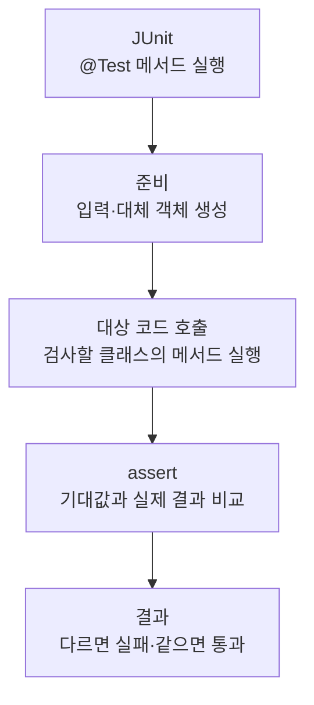

> [!info] 개발 중인 코드
> 2026-11-11 작업본 기준이다. 확정 설계가 아니며, 코드가 바뀌면 이 노트도 새 내용으로 바꿔요.

## 한눈에 보기

앱 시작 준비가 화면을 멈추지 않고 실행되는지, 실패한 뒤 다시 시도할 수 있는지 확인하는 검사예요.

- **현재 위치:** 자동 테스트
- **원본:** `src/test/java/kr/ac/university/localdb/ui/StartupPanelTest.java`
- **전체 안내:** [[전체_동작_흐름|전체_동작_흐름]] · [[목차|목차]]

EDT 밖 실행, 중복 시작 방지, 실패 안내 후 재시도 성공을 확인해요.

## 사용 장면과 읽는 순서

준비 버튼을 여러 번 눌러도 작업이 겹치면 안 되고, 처음 실패했더라도 다시 시도해 다음 화면으로 갈 수 있어야 해요.

1. 테스트가 필요한 입력과 시험용 환경을 먼저 준비해요. 실제 서비스 대신 예상한 응답을 주는 대체 코드를 쓰는 경우도 있어요.
2. 확인하려는 클래스의 함수를 호출하고 결과를 받아요.
3. assertEquals·assertTrue 같은 확인 문장으로 예상 결과와 실제 결과를 비교해요. 각각의 테스트 함수는 독립적인 검사예요.
4. 실제 DB 초기화를 매번 실행하는 대신 준비 작업을 시험용 동작으로 바꿔 확인해요.

모르는 용어는 [[문서_읽는법|문서 읽는 법과 용어 설명]]에서 찾아볼 수 있어요.

## 동작 순서

```text
JUnit이 @Test 메서드 실행 → 테스트용 입력/대체 객체 준비 → 대상 코드 호출 → assert로 기대 결과 확인
```

## 주요 메서드

| 메서드 | 하는 일 |
|---|---|
| `initializationRunsOffEdtAndDuplicateStartsAreIgnored()` | 초기화가 화면 밖 스레드에서 실행되고 중복 시작을 막는지 확인해요. |
| `failedInitializationShowsRetryAndCanRecover()` | 실패 안내 후 재시도로 정상 복구되는지 확인해요. |

## 사용한 Java 라이브러리·API

아래 표는 가져다 쓴 도구, 이 클래스에서 만나는 함수, 사용하는 이유를 연결해 보여줘요. JDK 기본은 Java에 포함된 기능이고, 별도 라이브러리는 프로젝트가 추가로 준비하는 도구예요. 처음에는 도구 이름을 외우기보다 마지막 열의 역할부터 읽어 보세요.

| 라이브러리·API | 사용 메서드/위치 | 여기서 하는 일 |
|---|---|---|
| Swing·AWT UI<br/>JDK 기본: java.desktop<br/>SwingUtilities, JButton, Component, Container | initializationRunsOffEdtAndDuplicateStartsAreIgnored(), failedInitializationShowsRetryAndCanRecover(), button() | 로그인/가입 UI를 만들고 그리며 EDT에서 화면을 새 내용으로 바꿔요. Desktop은 기본 브라우저 열기에도 쓰인다. |
| DB JDBC<br/>JDK 기본: java.sql / javax.sql<br/>SQLException | failedInitializationShowsRetryAndCanRecover() | DB 연결을 빌리고 매개변수가 있는 SQL을 실행해 행을 읽거나 변경한다. try (...)로 사용 자원을 닫는다. |
| 비동기·콜백<br/>JDK 기본: java.lang / java.util.concurrent / java.util.function<br/>Thread, CountDownLatch, TimeUnit, AtomicReference, AtomicInteger | initializationRunsOffEdtAndDuplicateStartsAreIgnored(), failedInitializationShowsRetryAndCanRecover() | 오래 걸리는 작업을 분리하고 완료 동작을 넘겨줘요. 테스트에서는 작업 완료를 기다리거나 결과를 보관해요. |
| JUnit 자동 검사<br/>외부: JUnit Jupiter 5.10.0<br/>Test, Assertions, assertEquals/assertTrue 등 | initializationRunsOffEdtAndDuplicateStartsAreIgnored(), failedInitializationShowsRetryAndCanRecover() | @Test로 검사 메서드를 지정하고 assertEquals/assertTrue 등으로 기대값을 확인해요. |

외부 라이브러리 버전과 전체 사용 위치: [[라이브러리_사용_안내|라이브러리 사용 안내]]

## 클래스 내부 함수 흐름도



개별 테스트는 각각 독립적으로 이 순서를 따른다. @Test 메서드끼리 순서대로 호출하는 구조는 아니다.

## 핵심 코드

원본 13행 부근의 일부 발췌다. 아래 코드만 따로 복사해 실행하는 예제는 아니다.

```java
void initializationRunsOffEdtAndDuplicateStartsAreIgnored() throws Exception {
    CountDownLatch entered = new CountDownLatch(1);
    CountDownLatch release = new CountDownLatch(1);
    CountDownLatch ready = new CountDownLatch(1);
    AtomicInteger attempts = new AtomicInteger();
    AtomicBoolean background = new AtomicBoolean();
    AtomicBoolean completedOnEdt = new AtomicBoolean();
    SwingUtilities.invokeAndWait(() -> {
        StartupPanel panel = new StartupPanel(() -> {
            attempts.incrementAndGet();
            background.set(!SwingUtilities.isEventDispatchThread());
            entered.countDown();
            if (!release.await(3, TimeUnit.SECONDS)) throw new IllegalStateException("Timed out");
            return null;
        }, () -> {
            completedOnEdt.set(SwingUtilities.isEventDispatchThread());
            ready.countDown();
        }, () -> {});
// ... 이후 코드는 원본 참고
```

## 변경할 때 주의할 점

작업은 콜백으로 대체하며 실제 DB 초기화를 매번 수행하지 않는다.

## 함께 읽기

[[05_회원_DB/StartupPanel|StartupPanel]]
