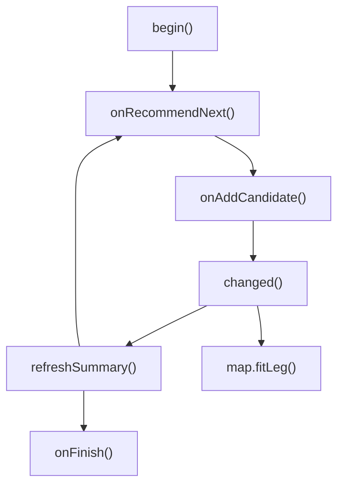

---
aliases:
  - "02_화면/RouteEditorController"
document_status: archived
archived_at: 2026-11-26
current_source: src/main/java/com/datecourse/page/_02step_editor/CourseEditorController.java
layout_updated: 2026-11-24
title: "보관 · CourseEditorController (이전 RouteEditorController)"
source: src/main/java/com/datecourse/controller/RouteEditorController.java
source_commit: ea2242b
source_sha256: 6fb9b6cda444a93b789a07f996fdfc94cb384676546f95c324f69fe0545f9330
readability_updated: 2026-11-14
reviewed_commit: 9e59289
reviewed_at: 2026-11-23
---

> **보관 문서 · 현재 구현 안내가 아닙니다.** 현재 소스와 다른 버전의 코드 발췌입니다. 원래 source_commit·source_sha256과 발췌는 당시 근거로 보존합니다. 현재 설명은 [[기능별_구현/목차|기능별 구현 문서]], 보관 사유는 [[99_이전_문서/목차|이전 문서 목록]]에서 확인하세요.


## 가독성 개선 · 2026-11-24

[[02_화면/화면_가독성과_작은_창_배치_2026_11_24|작은 창의 배치·정보 역할·글자 대비·알림 위치]]를 반영했어요. 아래 날짜가 붙은 발췌는 당시 기록이에요.

## 현재 이름·경로 · 2026-11-24

`CourseEditorController` → `src/main/java/com/datecourse/page/_02step_editor/CourseEditorController.java`. [[09_구조와_검토/페이지_구조와_이름_2026_11_24|페이지별 배치]]를 확인하세요. 아래 원본 링크·코드 발췌는 기존 `source_commit`의 기록이며 이름 변경 전 코드예요.


## 현재 구현 · 2026-11-23

같은 클래스 안에서 초기화 책임을 나누고 편집 초안·조건·후보를 관리해요. 기존 메서드·FXML 연결과 이벤트 등록 순서는 유지했어요.

| 주요 함수·구성 | 역할 |
|---|---|
| `initialize()` | 표시·필터, 지도·이동수단, 입력, 후보, 조건 이벤트, 코스 목록, 패널 전환 순서로 연결해요. |
| `configureConditionInputs()` | 가격·후보 수 등 기본값과 바인딩을 설정해요. |
| `refreshMap()` | 현재 선택 구간·후보·검색 범위를 반영해요. |

앱 코드 기준 `9e59289`. [[현재_구현_흐름|현재 흐름]] · [[변경_요약|변경 요약]]

<details>
<summary>이전 기준의 발췌와 학습 설명</summary>

# RouteEditorController

> 개발 중인 코드예요. `ea2242b` 기준이며, 후속 커밋에서 동작이 바뀔 수 있어요.

## 최신 변경 · 2026-11-15

세 영역 중 하나만 열고, 업종·상세 종류·태그·가격 필터와 후보 5~30곳 선택을 제공해요. 장소 추가 시 새 구간 포커스와 도보 시간·누적 시간을 갱신해요. 기존 장소의 반경은 추가 당시 다음 장소 조건을 수정하는 값이에요.

[[현재_구현_흐름|최신 사용 흐름]] · [[99_이전_문서/이전_안내/최종_검토_2026_11_15|검증 범위]]

## 현재 편집 흐름



## 이전 버전의 상세 설명

아래 함수표·발췌·원본 링크는 기존 source_commit 기준 기록이에요. 위 최신 변경과 함께 읽어 주세요.

## 한눈에 보기

추천 후보 최대 5곳 중 하나씩 선택해 편집 초안을 만들어요. 돌아가도 초안은 앱 안에 남아요.

## 코드 읽기

아래 선언부터 읽고 함수표의 순서로 찾아보세요. 전체 코드는 [기준 커밋의 원본](https://github.com/2egn/DateCourseApp/blob/ea2242b/src/main/java/com/datecourse/controller/RouteEditorController.java)에서 확인해요.

```java
public final class RouteEditorController extends BasePageController {
```

## 주요 함수

| 함수 | 하는 일 |
|---|---|
| `begin()` | 새 편집본과 후보 자료를 받아요. |
| `resume()` | 이전 초안·조건·선택을 유지해 다시 열어요. |
| `onRecommendNext()` | 전체 범위와 이전 장소 범위가 겹치는 후보를 찾아요. |
| `onFinish()` | 전체 범위와 구간 반경을 검사하고 문제가 없을 때 편집본을 메인으로 전달해요. |
| `onAddCandidate()` | 선택 후보를 코스에 추가하고 새 구간을 맞춰요. |
| `changed()` | refreshSummary()로 합계·유효성을 갱신하고 후보 상태와 지도를 정리해요. |
| `refreshSummary()` | 장소 수·누적 금액·구간 상태와 버튼을 갱신해요. |
| `map.fitLeg()` | 직전 장소와 새 장소 구간을 지도에 맞춰요. |
| `resetDraft()` | 초안의 장소·후보를 비우며 DB 코스는 지우지 않아요. |

## 동작 흐름

사용자 요청 또는 다른 클래스의 호출로 시작해요. 자세한 분기는 위 함수표와 원본 코드를 함께 봐요.


## 사용하는 라이브러리

| 도구 | 이 코드에서 필요한 이유 |
|---|---|
| JavaFX | 이벤트·화면·백그라운드 작업 |
| Java 컬렉션·함수 | 목록 복사·조건 처리·전달할 동작 |

라이브러리가 쓰이는 구체적인 위치는 위 함수표와 원본의 해당 함수 본문에서 확인해요. 화면 작업과 DB 작업을 같은 스레드에서 섞지 않는 것이 중요해요.

관련 안내: [[현재_구현_흐름|현재 전체 흐름]] · [[업데이트_내역|이번 변경]]


</details>
