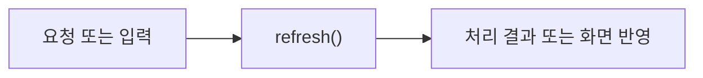

---
aliases:
  - "05_회원_DB/CapsLockHint"
document_status: archived
archived_at: 2026-11-26
title: "보관 · CapsLockHint"
source: src/main/java/kr/ac/university/localdb/ui/CapsLockHint.java
current_source: src/main/java/com/datecourse/page/common/swing/CapsLockHint.java
source_commit: ea2242b
source_sha256: af7b07a11e2aacc60ce198ef50b13b59091478c2bd198491fa8eb27355e56658
readability_updated: 2026-11-14
---

> **보관 문서 · 현재 구현 안내가 아닙니다.** 현재 소스와 다른 버전의 코드 발췌입니다. 원래 source_commit·source_sha256과 발췌는 당시 근거로 보존합니다. 현재 설명은 [[기능별_구현/목차|기능별 구현 문서]], 보관 사유는 [[99_이전_문서/목차|이전 문서 목록]]에서 확인하세요.


# CapsLockHint

> 개발 중인 코드예요. `ea2242b` 기준이며, 후속 커밋에서 동작이 바뀔 수 있어요.

## 한눈에 보기

비밀번호 아래 Caps Lock 안내를 보여줘요. 비밀번호 내용은 읽지 않아요.

## 코드 읽기

아래 선언부터 읽고 함수표의 순서로 찾아보세요. 전체 코드는 [기준 커밋의 원본](https://github.com/2egn/DateCourseApp/blob/ea2242b/src/main/java/com/datecourse/page/common/swing/CapsLockHint.java)에서 확인해요.

```java
final class CapsLockHint extends JLabel {
```

## 주요 함수

| 함수 | 하는 일 |
|---|---|
| `refresh()` | 포커스와 키보드 상태만 확인해 안내를 갱신해요. |

## 동작 흐름

사용자 요청 또는 다른 클래스의 호출로 시작해요. 자세한 분기는 위 함수표와 원본 코드를 함께 봐요.



## 사용하는 라이브러리

| 도구 | 이 코드에서 필요한 이유 |
|---|---|
| Swing | 로그인 UI·화면 이벤트 |
| Java 컬렉션·함수 | 목록 복사·조건 처리·전달할 동작 |

라이브러리가 쓰이는 구체적인 위치는 위 함수표와 원본의 해당 함수 본문에서 확인해요. 화면 작업과 DB 작업을 같은 스레드에서 섞지 않는 것이 중요해요.

관련 안내: [[현재_구현_흐름|현재 전체 흐름]] · [[업데이트_내역|이번 변경]]
