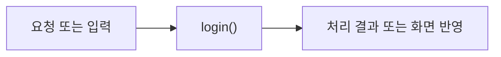

---
aliases:
  - "05_회원_DB/MembershipApp"
document_status: archived
archived_at: 2026-11-26
title: "보관 · MembershipApp"
source: src/main/java/kr/ac/university/localdb/ui/MembershipApp.java
current_source: src/main/java/com/datecourse/page/account/MembershipApp.java
source_commit: ea2242b
source_sha256: d737d81e8b5675f8103a47844304fefe4f0ce7936f5cb36dc4a5f6f70993a2d6
readability_updated: 2026-11-14
reviewed_commit: b69d00e
reviewed_at: 2026-11-15
---

> **보관 문서 · 현재 구현 안내가 아닙니다.** 현재 소스와 다른 버전의 코드 발췌입니다. 원래 source_commit·source_sha256과 발췌는 당시 근거로 보존합니다. 현재 설명은 [[기능별_구현/목차|기능별 구현 문서]], 보관 사유는 [[99_이전_문서/목차|이전 문서 목록]]에서 확인하세요.


# MembershipApp

> 개발 중인 코드예요. `ea2242b` 기준이며, 후속 커밋에서 동작이 바뀔 수 있어요.

## 최신 변경 · 2026-11-15

관리자 인증도 실제 연결돼 있어요. 같은 창에서 MemberAdminPanel과 제보 검토를 보여주고 로그아웃할 수 있어요. 일반 회원 종료는 JavaFX의 미저장 판단으로, 관리자 종료는 작업 중 여부와 회원 편집 확인으로 연결돼요.

[[현재_구현_흐름|최신 사용 흐름]] · [[99_이전_문서/이전_안내/최종_검토_2026_11_15|검증 범위]]

## 이전 버전의 상세 설명

아래 함수표·발췌·원본 링크는 기존 source_commit 기준 기록이에요. 위 최신 변경과 함께 읽어 주세요.

## 한눈에 보기

Swing 로그인·가입과 JavaFX 홈 화면의 이동을 담당해요. DB 연결 풀을 소유해요.

## 코드 읽기

아래 선언부터 읽고 함수표의 순서로 찾아보세요. 전체 코드는 [기준 커밋의 원본](https://github.com/2egn/DateCourseApp/blob/ea2242b/src/main/java/com/datecourse/page/account/MembershipApp.java)에서 확인해요.

```java
public class MembershipApp {
```

## 주요 함수

| 함수 | 하는 일 |
|---|---|
| `login()` | 인증 후 현재 회원 세션을 만들어요. |
| `loadConditionScreen()` | 저장소·회원·로그아웃 동작을 홈에 전달해요. |
| `logout()` | 비밀번호를 비우고 기존 로그인 화면으로 돌아가요. |
| `bringPlannerToFront()` | 전환 후 창과 입력 포커스를 요청해요. |

## 동작 흐름

사용자 요청 또는 다른 클래스의 호출로 시작해요. 자세한 분기는 위 함수표와 원본 코드를 함께 봐요.



## 사용하는 라이브러리

| 도구 | 이 코드에서 필요한 이유 |
|---|---|
| JavaFX | 이벤트·화면·백그라운드 작업 |
| Swing | 로그인 UI·화면 이벤트 |
| JDBC | SQL 요청과 행 읽기 |
| Java 컬렉션·함수 | 목록 복사·조건 처리·전달할 동작 |

라이브러리가 쓰이는 구체적인 위치는 위 함수표와 원본의 해당 함수 본문에서 확인해요. 화면 작업과 DB 작업을 같은 스레드에서 섞지 않는 것이 중요해요.

관련 안내: [[현재_구현_흐름|현재 전체 흐름]] · [[업데이트_내역|이번 변경]]
