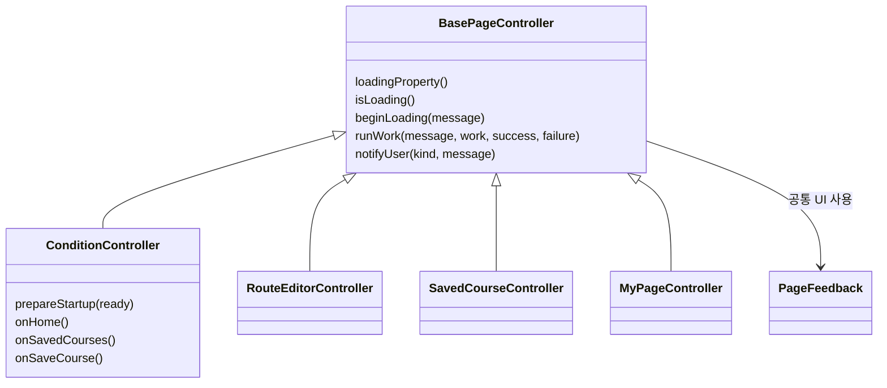
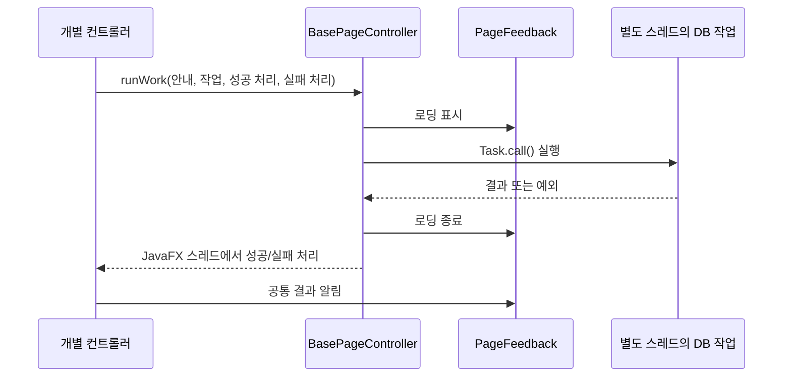

# 홈 메뉴와 공통 UI

구현일: 2026-11-14. 과제의 핵심 사용 흐름인 코스 생성·편집·저장 목록에 적용했다. 예전 샘플 커뮤니티·관리 화면의 통합은 별도 작업이다.

## 바뀐 사용 흐름

- 헤더에서 **코스 만들기 / 저장한 코스**로 이동한다. 생성·편집 메뉴를 하나로 합쳤다. 저장 목록은 별도 창 대신 같은 창 안에서 열린다.
- 사용자 이름은 헤더, **코스 초기화 / 코스 저장**은 공통 조건 화면 하단에 둔다. 편집 중에도 헤더 이동이 가능하다. 돌아가기·탭 이동은 장소·조건·후보 선택을 메모리에 유지하고, **이어서 편집**으로 돌아온다. 앱 종료 후 초안 복원은 별도 기능이다.
- 확정 코스 또는 남겨 둔 초안에 장소가 한 곳 이상 있으면 공통 조건 지도 클릭·검색 선택으로 출발지를 바꿀 수 없다. **코스 초기화** 후 변경하라는 알림을 표시한다. 지도와 Java 양쪽에서 막고, 초기화하면 해제한다. 지도 이동·확대와 구간 선택은 유지한다.
- 초기 상태와 코스 초기화 직후에는 초기화 버튼을 비활성화한다. 공통 조건 변경·위치 선택·코스 편집·저장 코스 로드가 있으면 다시 활성화한다.
- 저장 목록과 상세에는 DB의 `updated_at`을 **한국 시간**으로 표시한다. 별도 테이블 변경은 없다. 저장 코스를 불러올 때도 도보 경로를 자동 계산한다.
- 편집 화면에서는 장소 선택에 집중한다. **코스 저장할 때 이름을 입력**하며, 수정 저장은 기존 이름을 미리 채운다. 이름은 공백을 제거한 뒤 1~20자여야 한다. 취소하면 DB와 현재 코스를 바꾸지 않는다.
- 모든 알림은 오른쪽 위 작은 패널에 표시한다. 하단 바가 5초 동안 줄어든 뒤 0.25초 동안 투명해지며 닫힌다. 우측 상단 ×로 바로 닫을 수도 있다. 새 알림은 시간을 다시 시작한다. 기존 설명도 남겨 두어 알림이 닫힌 뒤 다시 읽을 수 있다.
- 로딩·알림은 화면 위에 겹쳐 띄우므로 지도의 크기를 바꾸지 않는다. 드롭다운과 선택 탭은 회색 계열이다.
- 긴 알림은 첫 문장 중심으로 줄이고 전체 내용은 알림 텍스트에 마우스를 올려 확인한다. 화면의 기존 오류 설명도 유지한다.
- 사용자 이름은 아래로 열리는 메뉴다. **내 페이지 / 로그아웃**을 제공하며 회원 정보가 없는 시연 모드에서는 비활성화한다. 내 페이지에는 이름·이메일·전화번호와 저장한 코스 이동을 제공한다. 회원 정보 수정은 이번 범위가 아니다.

## 상속으로 재사용하는 부분



`extends BasePageController`는 부모 클래스가 제공하는 기능을 물려받는다는 뜻이다. 자식 컨트롤러는 로딩 상태와 스레드 처리 코드를 복사하지 않고 부모 메서드를 호출한다. 장소 추천이나 코스 저장의 구체적인 동작은 각 자식 클래스가 담당한다.

`PageFeedback`은 팝업·로딩 표시를 그리는 공통 UI 클래스다. 네 컨트롤러는 홈 화면에서 만든 **같은 인스턴스**를 전달받는다. 이것은 상속과 구별되는 **객체 구성**이다. 공통 기능은 상속으로 재사용하고, 실제로 보여주는 UI 객체는 함께 사용한다.

`MyPageController`도 같은 부모를 상속한다. `configure()`로 전달받은 조회 동작을 부모의 `runWork()`에 넘겨 회원 정보를 읽는다. 화면에서 별도 DB 연결 풀을 만들지 않고 로그인 앱이 소유한 저장소를 사용한다. `MemberRepository.profile()`은 현재 회원 ID의 활성 계정만 읽고 비밀번호·해시는 조회하지 않는다.

로그아웃은 `ConditionController.onLogout()`에서 미저장 코스 확인 → 지도·비동기 작업·세션 정리 → `MembershipApp.logout()`에서 기존 Swing 로그인 화면 복귀 순서다. DB 연결 풀과 저장된 코스는 유지한다. 로그인 입력 이벤트를 중복 등록하지 않도록 로그인 화면을 새로 만들지 않고 재사용한다. 비밀번호는 비우고 아이디 저장 설정은 유지한다. JavaFX 실행 환경도 유지해 재로그인이 가능하게 한다.

DB 연결 풀·회원 세션·각 지도는 수명이 다르므로 부모 클래스의 전역 변수로 옮기지 않았다. DB 연결 풀은 로그인 앱이 소유하고 필요한 저장소만 전달한다. 두 지도는 편집 완료 전까지 독립 상태를 유지한다.

## 로딩 흐름



화면에서 읽을 로딩 플래그는 `loadingProperty()`다. 단순히 `true/false`만 대입하면 두 작업 중 하나가 끝났을 때 로딩을 너무 일찍 닫을 수 있어, 내부에서는 진행 중인 작업 수도 센다. 마지막 작업이 끝나야 플래그를 `false`로 바꾼다. 작업 취소도 종료 횟수에 포함한다.

`Runnable`은 ‘나중에 실행할 동작’을 전달하는 타입이다. `beginLoading()`이 돌려주는 `Runnable`을 실행하면 해당 작업의 로딩을 종료한다. 같은 종료 동작이 두 번 호출돼도 한 번만 반영한다. `runWork()`는 이 시작·종료와 JavaFX `Task` 연결을 대신 수행한다.

## 앱 시작 때 준비하는 것

1. 로그인 후 메인·편집 FXML 화면을 생성하고 첫 장소 DB 조회를 시작한다.
2. `prepareStartup()`에서 저장 목록 화면도 미리 생성하고 편집 지도 로딩을 시작한다.
3. 첫 장소 조회가 성공하거나 실패하면 기존 Swing 시작 로딩창을 닫고 메인을 보여 준다. 실패해도 앱 진입 후 다시 조회할 수 있다.
4. 저장 목록은 탭에 들어갈 때 최신 DB 값을 읽는다. 저장·수정·도보 경로 조회에도 공통 로딩을 사용한다.

외부 지도는 네트워크 상태에 따라 늦어질 수 있어 시작창 종료 조건으로 삼지 않는다. 지도 준비는 시작하지만 완료를 보장하지 않는다. 도보 경로는 선택한 코스가 있어야 조회할 수 있으므로 실제 요청 시 처리한다. Google 유료 API를 미리 호출하지 않는다.

## 코드 읽는 순서

| 순서 | 파일 | 확인할 부분 |
|---|---|---|
| 1 | `src/main/java/com/datecourse/controller/BasePageController.java` | 부모의 로딩 플래그와 `runWork`, `notifyUser` |
| 2 | 같은 폴더의 `PageFeedback.java` | 공통 로딩·알림 UI와 작업 횟수 |
| 3 | 같은 폴더의 `SavedCourseController.java` | 상속받은 `runWork`를 쓰는 짧은 실제 예시 |
| 4 | 같은 폴더의 `ConditionController.java` | 헤더 이동, 화면 재사용, `prepareStartup`, 저장 이름 입력 |
| 5 | `src/main/java/kr/ac/university/localdb/ui/MembershipApp.java` | 첫 준비 완료 후 시작 로딩창 종료 |

## 실행 확인

**편집 초기화**는 확인 후 담은 장소·방문 반경·후보만 비운다. 저장된 DB 코스는 지우지 않는다. **편집 완료**에서 기존 범위 검사를 통과해야 메인에 반영하고 DB 저장이 가능하다. 단순히 돌아가기는 메인·DB를 변경하지 않는다. 새 코스 생성·다른 저장 코스 불러오기는 남은 초안 교체 여부를 확인한다.

도보 경로 버튼은 메뉴 없이 바로 계산한다. **편집 완료 후에도 자동으로 계산**하며, 지도 준비가 늦으면 준비 완료 후 실행한다. 초기화 등으로 코스가 바뀌면 이전 예약·응답은 버린다. 자동 조회 완료 때 추가 확대·축소는 하지 않는다. 옵션은 별도 **도보 설정**에서 변경한다.

지도에는 구간별 색과 번호를 표시한다. **경로 설명**을 눌렀을 때만 상단 설명을 열고, 선이나 장소 핀을 누르면 해당 장소로 들어오는 구간(이전 장소 → 현재 장소)을 선택한다. 선택된 구간의 안내만 보여준다. 겹친 선 아래의 구간은 설명 패널의 구간 목록에서 선택할 수 있다. 안내 패널은 지도 크기를 바꾸지 않는다.

선·핀 클릭은 출발지 변경 이벤트로 이어지지 않는다. 클릭한 구간의 요약 팝업은 마우스를 떼어도 유지한다. 다른 구간을 클릭하면 새 팝업으로 바꾸고, 빈 지도 클릭은 팝업만 닫는다. 이 닫기 클릭에서는 출발지 변경 알림을 띄우지 않는다. hover 팝업 닫기도 같은 규칙이다.

고정 팝업이 있어도 다른 선을 hover하면 해당 선만 일시적으로 강조한다. 팝업 내용과 선택 구간은 바꾸지 않는다. hover가 끝나면 고정 팝업의 원래 구간을 다시 강조한다.

선 hover는 출발·도착·거리·시간을 표시한다. 박스는 명시적인 너비(최대 248px)를 사용하고, 지도 가장자리에서는 위치를 안으로 보정한다. 긴 이름은 내용 영역에서만 줄바꿈하고 거리·시간은 별도 행으로 구분한다.

이번 경로 변경을 읽을 때는 `ConditionController.hasCoursePlaces()`·`updateOriginProtection()` → `PlannerMap.setOriginLocked()` → 지도 `selectMapLocation()` 순서로 출발지 보호를 확인한다. 자동 조회는 `applyEdits()` → `requestWalkingRouteWhenReady()`, 구간 선택·설명은 `map.js`의 `showWalkingRoute()`·`selectWalkingLeg()`·`toggleWalkingExplanation()` 순서다.

```powershell
.\gradlew.bat run
```

로그인 → 헤더의 코스 생성·편집 → 저장 시 이름 입력 → 저장 목록 → 불러오기를 확인한다. 이름 입력 취소 시 저장되지 않는지, 새 코스와 수정 저장이 구분되는지 확인한다. DB 실패 시 오류 알림이 눈에 띄고 로딩이 닫히는지도 확인한다.

로그인 비밀번호 필드에 포커스가 있을 때 Caps Lock이 켜져 있으면 필드 아래 안내를 표시한다. 키 상태만 확인하며 비밀번호 내용을 읽지 않는다. 로그인 후 창의 크기를 바꾸기 전과 전환 완료 후에 Swing 창을 앞으로 가져오고 JFXPanel 포커스를 요청한다. Windows의 실제 Caps Lock 상태·다른 창과의 앞뒤 순서는 수동 실행에서도 확인한다.

자동 검사는 테스트 DB와 실제 FXML을 사용한다. 헤더의 저장 화면 재사용·복원, 이름 취소·빈 이름, 여러 작업의 로딩 유지, 실패 알림, 초기 조회 성공·실패 후 시작 준비 완료, 작은 창의 지도 크기를 검사한다. 실제 네트워크 지도와 Swing 시작창의 최종 체감은 수동 실행에서 확인한다.
