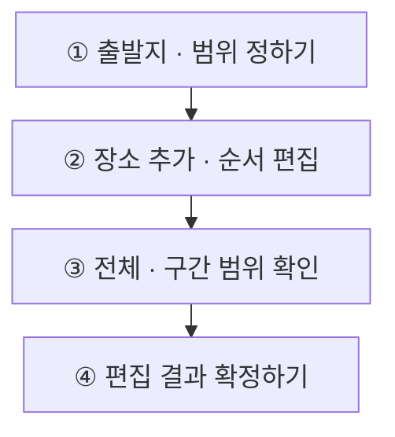

# 기본 조건 설정·코스 편집

**출발지·인원·전체 반경·수단을 정하고 장소 추가·삭제·순서·도착 반경을 편집한다.**

[[기능별_구현/목차|기능별 목차]] · [[10_구현_안내/구현_흐름_한눈에_보기_2026_11_25|짧은 전체 흐름]] · 사용자 기능

## 한눈에 보는 동작

## 예시로 이해하기

가상 상황: 식당 → 카페 → 박물관 순서를 식당 → 박물관 → 카페로 바꾼다. 바뀐 이웃 장소 사이의 범위를 다시 확인하며, 허용 범위를 벗어나면 그대로 편집 완료 처리하지 않는다.

## 무엇을 사용했고 왜 필요한가

| 사용하는 기술·클래스 | 필요한 기능 | 실제 처리 |
|---|---|---|
| JavaFX · FXML · ObservableList | 입력 이벤트와 목록 변경을 화면에 연결 | 컨트롤러가 입력·목록·지도 갱신을 조율한다. |
| RoutePlan · 컬렉션 복사 | 계획과 편집 중인 값을 구분 | 선택 순서·반경·인원·수단을 계획 값으로 전달한다. |
| RouteRangeValidator · TravelMode | 범위 정책을 일관되게 적용 | 전체 범위와 변경된 구간을 다시 확인한다. |

핵심 코드와 연결해서 보기

| 동작 | 중심 코드 | 핵심 처리 |
|---|---|---|
| 편집 진입 | CoursePlannerController · onRecommendClick() | 기본 조건 확인 후 계획 스냅샷으로 편집 화면 진입 |
| 초안 구성 | CourseEditorController · begin() | 계획을 받아 편집 목록·반경·콜백 구성 |
| 추가·이동·삭제 | CourseEditorController · onAddCandidate(), move(), onRemove() | 초안을 바꾸고 합계·범위·지도 갱신 |
| 완료 | CourseEditorController · onFinish() | 범위 초과가 없는지 확인 후 완료 콜백에 계획 전달 |

## 현재 구현의 범위

편집 완료와 DB 저장은 별도다. 편집 화면을 벗어나거나 취소하는 동작을 무조건 초안 폐기로 설명하지 않는다. 자동 최적 방문 순서를 계산하는 기능은 아니다.

관련 설명: [[10_구현_안내/구현_참조_자료_길잡이_2026_11_25|화면 동작과 핵심 클래스 연결]] · [[10_구현_안내/구현_참조_자료_길잡이_2026_11_25|모델: 값과 책임을 왜 분리했는가]]

소스 기준 `a0d9436` · 문서 확인 2026-11-25. 설명용 예시는 새 API 호출·운영 DB 검증 결과와 구분한다.

다음 기능: [[기능별_구현/03-recommendation|장소 후보 검색·조건 조정]]
