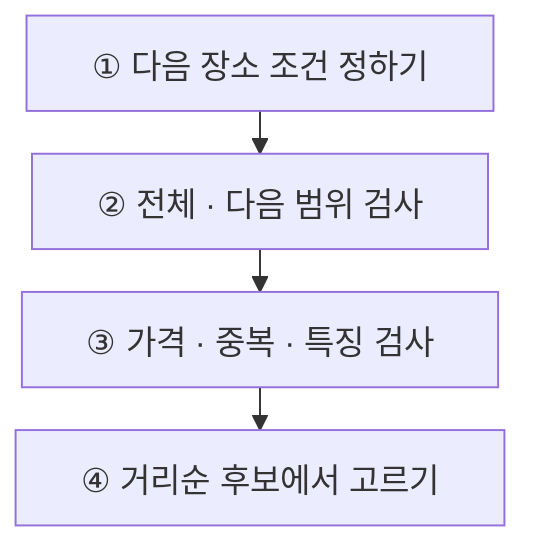

# 장소 후보 검색·조건 조정

**활동·가격·전체/다음 반경·유형·특징에 맞는 다음 장소를 찾아 사용자가 고르게 한다.**

[[기능별_구현/목차|기능별 목차]] · [[10_구현_안내/구현_흐름_한눈에_보기_2026_11_25|짧은 전체 흐름]] · 사용자 기능

## 한눈에 보는 동작

## 예시로 이해하기

가상 카페 8곳에 500m·1만 원 이하·포장 가능 조건을 적용하면 3곳이 남는 예시를 전체 흐름 문서에서 확인할 수 있다. 표시 수가 5여도 조건에 맞는 3곳만 보여준다.

## 무엇을 사용했고 왜 필요한가

| 사용하는 기술·클래스 | 필요한 기능 | 실제 처리 |
|---|---|---|
| NextPlaceCondition | 여러 화면 조건을 한 단위로 전달 | 가격·반경·활동·표시 수를 생성 시 확인한다. |
| 구면 거리 계산 · Stream 필터 | 범위와 조건을 만족하는 후보 찾기 | 전체 조건을 거친 뒤 표시 수를 제한한다. |
| CandidateRecoveryService | 결과가 없을 때 변경 가능한 조건 안내 | 단일 조건 변경 대안을 계산하고 사용자가 선택하게 한다. |

핵심 코드와 연결해서 보기

| 동작 | 중심 코드 | 핵심 처리 |
|---|---|---|
| 검색 이벤트 | CourseEditorController · onRecommendNext() | 현재 화면 조건으로 검색 요청 |
| 기본 후보 | PlaceSearchService · nearby() | 전체 범위·활동·좌표·동일성 검사 |
| 필수 조건 | NextPlaceService · matching() | 다음 거리·가격·선택 중복·유형·특징 적용 |
| 표시 수 | CourseEditorController · displayCandidates() | 전체 일치 결과에서 선택한 수만 표시 |

## 현재 구현의 범위

직선 거리 기준의 조건 검색이며 실제 최단 시간·코스 전체 예산·개인화 학습의 최적화가 아니다. 특징 UNKNOWN은 불가능 확정이 아니며, 필수 특징이 확인되지 않아 통과하지 못한다는 뜻이다.

관련 설명: [[10_구현_안내/구현_흐름_한눈에_보기_2026_11_25|구현 흐름 한눈에 보기]] · [[10_구현_안내/구현_참조_자료_길잡이_2026_11_25|장소 추천: 실제 순서·논리·한계]]

소스 기준 `a0d9436` · 문서 확인 2026-11-25. 설명용 예시는 새 API 호출·운영 DB 검증 결과와 구분한다.

다음 기능: [[기능별_구현/04-price-and-models|장소 상세·가격 근거·예상 비용]]

## 2026-11-27 반영

추천은 `NextPlaceCondition` 인수로 통일. `matching()`은 전체 후보, `candidates()`는 표시 개수 제한 결과. 이전 인수 나열 오버로드·기본값 별칭은 제거했다.

### 컨트롤러 읽기 순서

후보 검색 진입점은 `onRecommendNext()`. 같은 클래스의 `readNextPlaceCondition()`에서 조건 구성, 기존 검색 후 `applyCandidateSearch()`에서 요청 번호를 확인하고 결과 반영.
