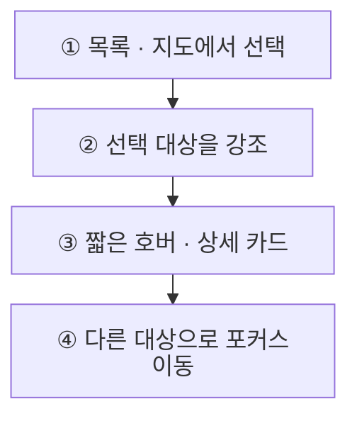

# 지도 탐색·마커·장소와 경로 상세

**장소 목록과 지도를 연결하고 짧은 호버 안내·선택 강조·상세 카드로 같은 장소나 구간을 탐색한다.**

[[기능별_구현/목차|기능별 목차]] · [[10_구현_안내/구현_흐름_한눈에_보기_2026_11_25|짧은 전체 흐름]] · 사용자 기능

## 한눈에 보는 동작

## 예시로 이해하기

가상 상황: 지도에서 카페 마커를 누르면 장소 상세를 확인한다. 다른 구간을 선택하면 강조 대상을 옮긴다. 마커와 선이 겹친 지점은 마커 입력을 우선하고 지도 위 전환 버튼은 컨트롤로 처리한다.

## 무엇을 사용했고 왜 필요한가

| 사용하는 기술·클래스 | 필요한 기능 | 실제 처리 |
|---|---|---|
| JavaFX WebView · 카카오 지도 SDK | Java 화면 안에서 웹 지도 사용 | 로컬 지도 페이지에 SDK를 로드한다. |
| Jackson JSON · MapEventBridge | Java 값과 웹 지도 이벤트 연결 | 표시 데이터는 Java → JS, 지도 선택은 브리지 → Java로 전달한다. |
| JS 모듈 · 뷰포트 보정 | 마커 우선 입력·단일 호버·렌더링 여유 영역 | 표시 상태·좌표·카메라·실제 보이는 영역을 조정한다. |

핵심 코드와 연결해서 보기

| 동작 | 중심 코드 | 핵심 처리 |
|---|---|---|
| 상세 연결 | CourseMapView · showDetail() | Java의 장소 선택을 지도 상세 표시로 연결 |
| 이벤트 연결 | MapEventBridge | 웹 지도 이벤트를 Java 콜백으로 전달 |

관련 자원: src/main/resources/map/map.js

관련 자원: src/main/resources/map/itinerary-rail.js

관련 자원: src/main/resources/map/pin-pointer-gesture.js

관련 자원: src/main/resources/map/map-viewport.js

## 현재 구현의 범위

마커는 기본 반투명이고 호버·포커스에서 강조한다. 여유 렌더링은 짧은 이동의 공백을 줄이는 방법이며 모든 타일·네트워크 로딩을 없애지는 않는다. 지도에 그려진 기본 연결과 실제 길찾기 경로를 구분한다.

관련 설명: [[10_구현_안내/구현_참조_자료_길잡이_2026_11_25|화면 동작과 핵심 클래스 연결]] · [[10_구현_안내/기능별_코드_흐름_2026_11_25#map|기능별 코드 흐름 자세히 보기]]

소스 기준 `a0d9436` · 문서 확인 2026-11-25. 설명용 예시는 새 API 호출·운영 DB 검증 결과와 구분한다.

다음 기능: [[기능별_구현/06-routing|실제 경로·이동수단·이동시간]]
