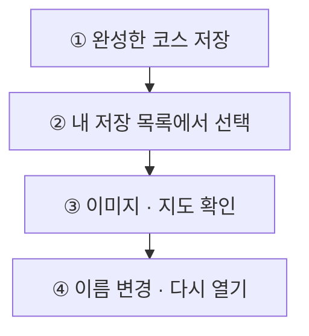

# 코스 저장·목록 관리·이미지와 지도

**완성한 코스를 회원별로 저장하고 다시 열기·이름 변경·삭제와 이미지/지도 전환을 제공한다.**

[[기능별_구현/목차|기능별 목차]] · [[10_구현_안내/구현_흐름_한눈에_보기_2026_11_25|짧은 전체 흐름]] · 사용자 기능

## 한눈에 보는 동작

## 예시로 이해하기

가상 상황: 이미지가 있는 코스를 다시 열면 PNG를 먼저 본다. 지도 탭에서 지도 불러오기를 누르면 이번 로그인 세션에서 준비한 상태를 기억한다. 로그아웃·목록 무효화 후에도 준비 상태가 영구 유지되는 것은 아니다.

## 무엇을 사용했고 왜 필요한가

| 사용하는 기술·클래스 | 필요한 기능 | 실제 처리 |
|---|---|---|
| JDBC 트랜잭션 · 회원 조건 | 관련 코스 데이터를 한 묶음으로 저장 | 본문·방문 순서·반경·수단을 commit/rollback하고 조회·수정에 회원 조건을 적용한다. |
| 장소 스냅샷 · Jackson | 원본 변화와 별개로 저장 당시 정보 복원 | 장소 ID만이 아니라 당시 장소·가격·상세도 보관한다. |
| PNG · 내용 지문 · 세션 메모리 | 이미지와 현재 코스·지도 준비 여부 구분 | 이미지 지문을 확인하고 지도 준비 상태는 UserContext에서만 기억한다. |

핵심 코드와 연결해서 보기

| 동작 | 중심 코드 | 핵심 처리 |
|---|---|---|
| 본문 저장 | CoursePlannerController · onSaveCourse() | 현재 계획을 saveWithoutPreview 경로로 저장 |
| 영속화 | SavedCourseRepository · persist(), findAll(), rename(), delete() | 회원별 저장·조회·이름 변경·삭제 |
| 이미지/지도 | SavedCourseController · onSelectMap(), onSelectImage(), onLoadMap() | 이미지 확인 상태와 지도 준비 여부로 표시 결정 |
| 세션 준비 상태 | UserContext · isMapPrepared(), markMapPrepared(), invalidateCourses() | 같은 세션의 준비 여부를 관리하고 목록 갱신 시 무효화 |

## 현재 구현의 범위

이미지 로딩 중을 이미지 없음으로 판단하지 않는다. 이미지 없음이 확인되면 지도·기본 연결을 표시하고 지도 실패 시 로컬 연결도로 대체한다. 실제 길찾기는 별도 요청이다. 현재 본문 저장이 항상 SDK 이미지를 함께 저장하는 것은 아니며 다른 앱의 오래된 편집본 덮어쓰기를 막는 버전 조건도 남은 개선 항목이다.

관련 설명: [[10_구현_안내/구현_참조_자료_길잡이_2026_11_25|회원·코스 저장·정정·DB]] · [[10_구현_안내/기능별_코드_흐름_2026_11_25#storage|기능별 코드 흐름 자세히 보기]]

소스 기준 `a0d9436` · 문서 확인 2026-11-25. 설명용 예시는 새 API 호출·운영 DB 검증 결과와 구분한다.

다음 기능: [[기능별_구현/08-reports-admin|장소 정정 제보·관리자 회원 관리]]

## 2026-11-27 반영

`SavedCoursePresenter`가 기존 표 행을 내부 record로 구성해 `SavedCourseController`에 직접 전달. 줄바꿈·콜론·번호로 설명 문자열을 다시 분해하지 않으며 장소명·주소의 원래 문자를 보존한다.
