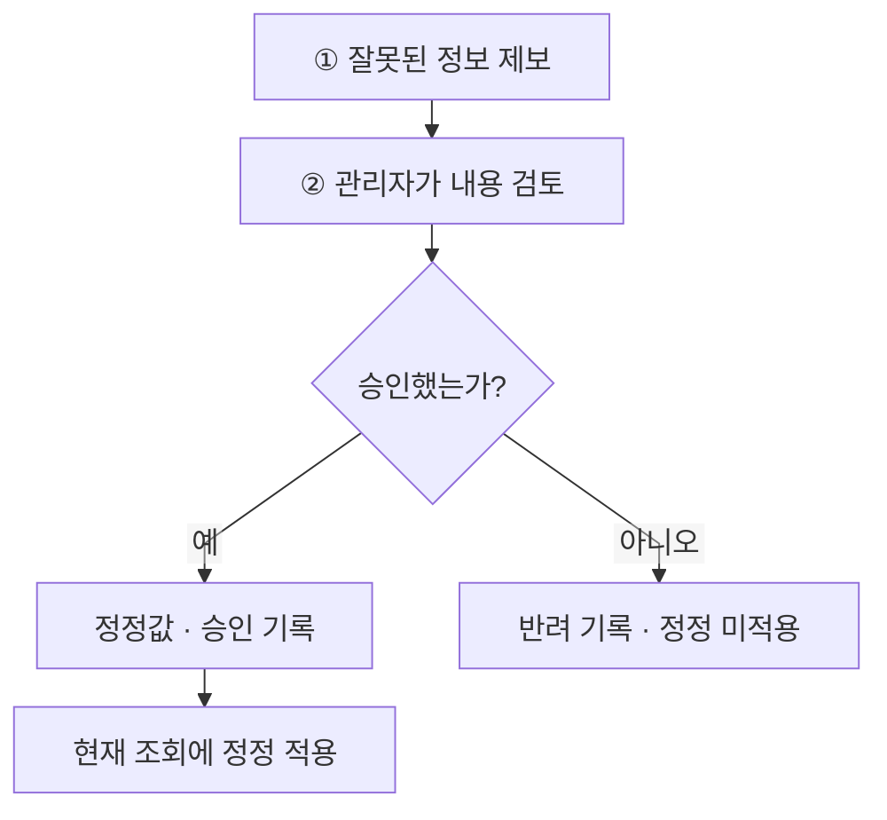

# 장소 정정 제보·관리자 회원 관리

**활성 회원은 장소의 잘못된 정보를 제보하고 관리자는 검토 후 승인·반려하거나 회원 상태를 관리한다.**

[[기능별_구현/목차|기능별 목차]] · [[구현_흐름_한눈에_보기_2026_11_25|짧은 전체 흐름]] · 사용자 기능 · 관리자 기능

## 한눈에 보는 동작

## 예시로 이해하기

가상 상황: 회원이 장소 주소가 바뀌었다고 제보한다. 제보 즉시 원본을 바꾸지 않고 관리자 승인 후 현재 장소 조회에 정정값을 겹쳐 적용한다. 과거에 저장한 코스 스냅샷은 그대로다.

## 무엇을 사용했고 왜 필요한가

| 사용하는 기술·클래스 | 필요한 기능 | 실제 처리 |
|---|---|---|
| InformationReport · JDBC | 제안과 승인된 정정값을 구분 | 원래 값·제안·사유·출처를 제보로 저장한다. |
| AdminSession · 트랜잭션 · 행 잠금 | 관리 경로와 중복/충돌 검토 제어 | 인증된 관리 경로에서 대기 상태·기존 정정값 변경 여부를 확인한다. |
| 정정값 별도 보관 | 공공 원본과 저장 스냅샷 보존 | 조회 때 적용하고 원본 카탈로그나 과거 코스를 직접 다시 쓰지 않는다. |

핵심 코드와 연결해서 보기

| 동작 | 중심 코드 | 핵심 처리 |
|---|---|---|
| 제보 제출 | InformationReportRepository · submit() | 활성 회원·장소·필드·입력을 확인해 대기 제보 저장 |
| 검토·적용 | InformationReportRepository · review(), apply() | 승인/반려와 검토값 기록, 현재 장소 조회에 정정 적용 |
| 관리자 경로 | MemberRepository.AdminSession · reviewInformation(), changeStatus(), deleteInactive() | 인증된 AdminSession에서 검토·회원 상태·제한된 삭제 처리 |
| 관리 화면 | MemberAdminPanel | 회원 조회·관리와 제보 검토 화면 연결 |

## 현재 구현의 범위

제보 대상은 1인 기준 가격·세부 업종·장소명·주소다. 임의의 모든 원본 필드를 수정하는 편집기는 아니다. 다른 검토가 정정값을 바꾸면 다시 확인하게 하며 회원 삭제도 상태·참조 제한을 확인한다. 클라이언트의 관리자 경로를 서버 중심 권한 구조와 동일하게 설명하지 않는다.

관련 설명: [[구현_참조_자료_길잡이_2026_11_25|회원·코스 저장·정정·DB]] · [[구현_참조_자료_길잡이_2026_11_25|모델: 값과 책임을 왜 분리했는가]]

소스 기준 `a0d9436` · 문서 확인 2026-11-25. 설명용 예시는 새 API 호출·운영 DB 검증 결과와 구분한다.

다음 기능: [[기능별_구현/09-ui-state|로딩·실패 안내·입력·화면 상태]]
