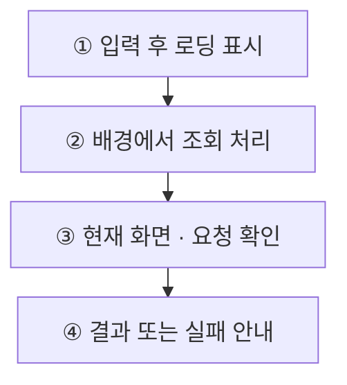

# 로딩·실패 안내·입력·화면 상태

**시간이 걸리는 조회 중 상태를 보여주고 오래된 응답·선택 강조·키보드 포커스·작은 창 배치를 관리한다.**

[[기능별_구현/목차|기능별 목차]] · [[구현_흐름_한눈에_보기_2026_11_25|짧은 전체 흐름]] · 여러 기능의 공통 처리

## 한눈에 보는 동작

## 예시로 이해하기

가상 상황: 저장 코스 A의 이미지 조회 중 B를 선택한다. 뒤늦게 A 이미지가 와도 현재 선택·요청 버전을 확인해 B 화면에 섞지 않는다. 상세를 닫으면 관련 목록 등으로 포커스를 돌려 탐색을 이어간다.

## 무엇을 사용했고 왜 필요한가

| 사용하는 기술·클래스 | 필요한 기능 | 실제 처리 |
|---|---|---|
| JavaFX Task · CompletableFuture | DB/HTTP 대기와 UI 갱신 분리 | runWork는 배경 작업, showFuture는 공유 조회 결과를 UI에 연결한다. |
| 요청 번호 · 세션 · 설정 버전 | 늦은 응답이 다른 화면을 덮지 않도록 제한 | 완료 시 현재 사용자·선택 코스·조건과 대조한다. |
| FXML/CSS · 키보드 이벤트 · WebView 수명 | 화면 크기와 입력 경로에 맞춘 표시 | 목록 Enter·상세 닫기·Tab·표시 크기를 반영한다. |

핵심 코드와 연결해서 보기

| 동작 | 중심 코드 | 핵심 처리 |
|---|---|---|
| 공통 비동기 | BasePageController · runWork(), showFuture() | 배경 작업·로딩·UI 콜백·실패 안내 연결 |
| 공유 조회 | UserContext · courses(), preview(), invalidateCourses() | 목록·미리보기 조회 재사용과 무효화 |
| 저장 화면 | SavedCourseController · loadCourses() | 세션·현재 요청을 확인하며 저장 코스 목록 표시 |

관련 자원: src/main/resources/map/itinerary-rail.js

관련 자원: src/main/resources/map/map-viewport.js

## 현재 구현의 범위

취소·화면 전환이 이미 진행 중인 DB/HTTP 작업을 항상 즉시 중단시키는 것은 아니다. 자동 검사는 실제 손 입력·배율·모니터 이동·느린 네트워크 확인을 모두 대신하지 않는다. 전체 접근성 기준 준수를 검증했다고 주장하지 않는다.

관련 설명: [[구현_참조_자료_길잡이_2026_11_25|화면 동작과 핵심 클래스 연결]] · [[구현_참조_자료_길잡이_2026_11_25|검증·팀 사이트·협업 지원]]

소스 기준 `a0d9436` · 문서 확인 2026-11-25. 설명용 예시는 새 API 호출·운영 DB 검증 결과와 구분한다.

다음 기능: [[기능별_구현/10-place-data|장소 데이터 수집·가격 보완·카탈로그]]
