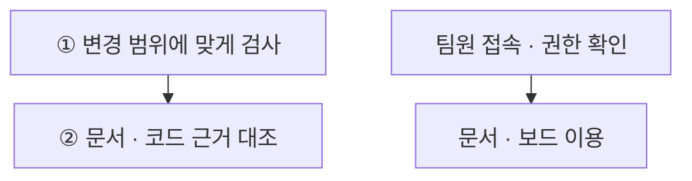

# 팀 문서·공유 보드·자동 검증

**코드 설명과 구현 상태를 팀에서 찾아보고 공유 보드·접근 권한·검증 기록을 관리한다.**

[[기능별_구현/목차|기능별 목차]] · [[10_구현_안내/구현_흐름_한눈에_보기_2026_11_25|짧은 전체 흐름]] · 협업 · 개발 지원

## 한눈에 보는 동작

## 예시로 이해하기

가상 상황: 팀원이 문서에서 저장 기능을 확인하고 담당 작업 상태를 바꾼다. 보드 기록은 공유 상태로 보관하며 자동 갱신은 기존 사람의 수정·담당·보관 상태를 덮지 않도록 제한한다. 문서 빌드 완료가 운영 배포 완료를 뜻하지 않는다.

## 무엇을 사용했고 왜 필요한가

| 사용하는 기술·클래스 | 필요한 기능 | 실제 처리 |
|---|---|---|
| JUnit/H2 · Python unittest · Node test | 앱·자료·사이트 규칙의 회귀 확인 | 모델·저장·필터·권한·이력 등을 모의 입력과 검사 DB로 검증한다. |
| Markdown · Quartz · Playwright | 읽을 수 있는 문서 생성과 표시 확인 | 사이트 로컬 빌드 후 도식·링크·모바일·DOM 상태 확인. |
| Worker · GitHub OAuth · Durable Object SQLite | 팀원 접근과 보드의 공유 상태 관리 | 사이트 요청 인증 후 문서·보드·허용된 연동 인터페이스 제공. |

핵심 코드와 연결해서 보기

관련 자원: docs/site/src/worker.mjs

관련 자원: docs/site/src/board-store.mjs

관련 자원: docs/site/src/agent-store.mjs

관련 자원: docs/site/src/app-keys.mjs

관련 자원: docs/site/tools/build.mjs

관련 자원: docs/site/tools/compact-docs.mjs

## 현재 구현의 범위

앱 회원 로그인과 사이트 GitHub 로그인은 별개다. 에이전트/문서 연동도 동의·권한·토큰·허용된 읽기 범위를 가진 별도 지원 경로다. 자동 검사 통과가 모든 실제 공급사·운영 DB·물리 입력 검증을 의미하지 않는다. 원격 푸시·통합·배포는 별도 승인된 절차다.

관련 설명: [[10_구현_안내/구현_참조_자료_길잡이_2026_11_25|검증·팀 사이트·협업 지원]]

소스 기준 `a0d9436` · 문서 확인 2026-11-25. 설명용 예시는 새 API 호출·운영 DB 검증 결과와 구분한다.
