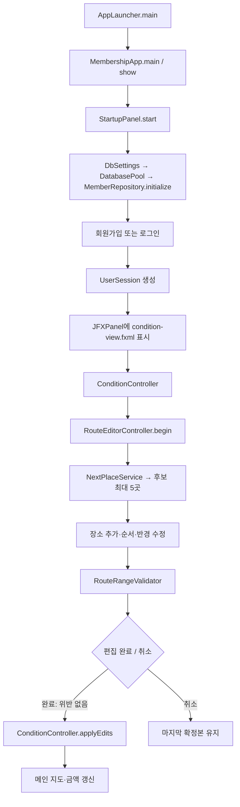

> **최신 안내:** 이 페이지에는 이전 버전 기록이 포함돼요. ea2242b의 저장·조회·공통 UI는 [[현재_구현_흐름|현재 전체 흐름]]과 [[업데이트_내역|업데이트 내역]]을 먼저 확인하세요.

> **기준 버전:** 이 전체 흐름은 초기 편집 구현 설명이다. `d32bc76`의 내장 지도 서버·TMAP 도보 기능과 다음 구현 순서는 [[리뷰_및_구현_방향|최신 리뷰]]와 [[업데이트_내역|업데이트 내역]]에서 확인한다.

# DateCourseApp 전체 동작 흐름

> [!info] 이 문서의 기준
> 2026-11-11 로컬 작업본을 읽어 정리했다. 기준 커밋은 `45a347c`지만, 그 이후 수정·신규 파일도 포함한다. 배포 완료 설계서가 아니다. 실제 소스와 달라지면 소스를 기준으로 노트를 갱신한다.

## 1. 무엇을 만드는 프로젝트인가

이 앱은 출발지와 인원을 정한 뒤, 식당·카페 같은 장소를 하나씩 골라 데이트 코스를 만드는 PC 프로그램이에요. 예를 들어 출발지를 정하고 → 식당 후보 중 한 곳을 고르고 → 그 주변 카페를 더하고 → 순서를 고친 뒤 코스를 확정하는 흐름이에요.

로그인 화면은 Swing, 코스 화면은 JavaFX라는 Java 화면 도구로 만들었어요. Java가 장소 추천·거리 검사·금액 계산을 하고, 화면 안의 JavaScript 지도가 장소와 경로를 보여줘요.

**처음에는 2~4절의 사용자 흐름부터 읽고, 뒤의 긴 클래스 표는 파일을 찾을 때 참고하세요.** 모르는 Java 표현은 [[문서_읽는법|문서 읽는 법]]에 예시와 함께 정리했어요.

현재 코스 한 개의 정보를 담는 데이터는 `RoutePlan`이에요. `Course`와 `CourseEditController`는 예전·예제 화면에서 사용해요. 이름이 비슷해도 현재 편집 흐름과 같은 것으로 읽으면 안 돼요.

## 2. 실제 앱 실행 흐름

1. [[01_시작/AppLauncher|AppLauncher]]로 앱을 시작하면 [[05_회원_DB/MembershipApp|MembershipApp]]이 로그인·가입 화면을 준비해요.
2. DB 준비가 끝나면 회원가입 또는 로그인을 해요. DB는 회원·장소 정보를 남기는 저장소예요.
3. 로그인한 회원 번호와 이름을 [[05_회원_DB/UserSession|UserSession]]에 묶어 코스 화면으로 넘겨요.
4. [[02_화면/ConditionController|메인 화면]]에서 출발지·인원·전체 허용 거리를 정하고 편집을 열어요.
5. [[02_화면/RouteEditorController|편집 화면]]에서 장소를 하나씩 고르고, 거리 제한을 확인한 뒤 완료하거나 취소해요.

아래 그림은 초기 편집 흐름의 연결 관계예요. 함수 이름을 먼저 외우기보다 위 다섯 단계가 그림의 어느 부분인지 찾아보세요.



### 가입과 로그인

| 순서 | 코드 | 설명 |
|---|---|---|
| 1 | `AppLauncher.main()` | 실행을 `MembershipApp`에 넘긴다. |
| 2 | `MembershipApp.show()` | 로그인·회원가입·시작 준비 화면을 연결한다. |
| 3 | `StartupPanel.start()` | DB 초기화는 작업 스레드에서 처리한다. 실패하면 재시도한다. |
| 4 | `register()` → `PasswordHash.create()` | 비밀번호를 해시로 만들고 회원을 DB에 저장한다. |
| 5 | `login()` → `PasswordHash.verify()` | 회원의 비밀번호·ACTIVE 상태를 확인한다. |
| 6 | `showConditionScreen()` | 같은 Swing 창 안에 JavaFX 화면을 넣고 세션·장소 저장소를 넘긴다. |

`MemberRepository.login()`은 현재 일반 회원 인증만 수행한다. 관리자 관련 테이블·화면·내부 타입이 있어도 실제 관리자 로그인 연결이 완성된 상태는 아니다.

### 공통 조건과 장소 조회

```text
ConditionController.setPlaceRepository()
  → loadPlaces()의 Task
  → PlaceRepository.findAll()
  → DB data_payload JSON → Place 목록
  → 메인 컨트롤러가 목록 보관

지도 검색 또는 클릭
  → map.js → MapBridge.onLocationSelected()
  → ConditionController.onLocationSelected()
  → 출발지·전체 범위 미리보기 갱신
```

공통 조건은 코스 전체에서 함께 쓰는 출발지·인원·전체 허용 거리예요. 출발지에서 일정 거리 안이라는 조건을 지도에서는 원으로 보여줘요. 총예산은 따로 입력하지 않고, 지금까지 고른 장소의 예상 금액을 보여줘요.

장소를 DB에서 가져오는 코드는 PlaceRepository, 가져온 목록을 가지고 후보를 고르는 코드는 NextPlaceService예요. ‘자료를 읽기’와 ‘추천할 곳을 고르기’를 나눠 생각하면 따라가기 쉬워요.

## 그림으로 보는 두 거리 조건

출발지 중심 전체 범위와 이전 장소 중심 범위에 모두 들어오는 장소만 거리 조건을 통과해요. 실제 추천은 활동·가격·중복 조건도 확인해요.

<div class="learning-demo" data-learning="ranges"></div>

### 장소 한 개 추천·선택

```text
RouteEditorController.onRecommendNext()
  → NextPlaceService.candidates()
  → 출발지 전체 반경 안의 장소
  → 이전 장소 기준 반경 안의 장소 (첫 장소는 출발지 기준)
  → 활동·1인 가격 상한·중복 제외
  → 거리순 최대 5개 후보
  → 상세 확인 또는 선택
  → onAddCandidate(): 장소와 그 장소의 허용 이동 반경 보관
```

| 편집 상태 | 펼쳐지는 내용 | 접히는 내용 |
|---|---|---|
| `CONDITION` | 다음 장소 조건 | 추천 후보 |
| `CHOICE` | 추천 후보 | 다음 장소 조건 |

예를 들어 전체 범위는 출발지에서 1km, 다음 장소는 이전 식당에서 300m 안이라고 해 보세요. 후보는 두 범위를 **모두** 만족해야 해요. 이렇게 겹치는 영역을 교집합이라고 불러요. 그 안에서 활동 종류·1인 가격 조건을 적용하고 이미 고른 장소를 제외해요.

후보나 상세정보를 보는 것과 장소를 코스에 넣는 것은 달라요. 사용자가 ‘추가’를 눌렀을 때만 그 장소가 편집 목록에 들어가요. 현재 추천은 거리순 최대 5곳이며 취향·별점을 종합한 점수순은 아니에요.

## 그림으로 보는 편집본과 확정본

원래 코스를 복사해 편집하고, 취소하면 원래 코스를 유지해요. 완료했을 때만 편집 결과를 메인에 반영해요. DB 저장은 별도예요.

<div class="learning-demo" data-learning="draft"></div>

## 3. 편집본과 확정본은 어떻게 분리되는가

| 값 | 소유자 | 역할 |
|---|---|---|
| `appliedPlan` | ConditionController | 마지막 편집 완료 결과 |
| `original` | RouteEditorController | 편집을 시작할 때 받은 조건 |
| `draftPlaces` | RouteEditorController | 현재 편집하는 장소 순서 |
| `arrivalRadii` | RoutePlan / 편집 컨트롤러 | 장소 recordId → 그 장소로 들어가는 허용 거리(m) |
| `PlannerMap` 두 개 | 각 화면 | 메인 지도와 편집 지도 상태를 각각 관리 |

**확정본**은 메인 화면이 보여주는 현재 코스이고, **편집본**은 지금 고치고 있는 복사본이에요. 메인에서 편집 화면을 열 때 장소 목록과 장소별 허용 거리 표를 복사해요.

예를 들어 원래 코스가 식당→카페인데 편집 중 카페를 지웠다고 해 보세요. 완료를 누르기 전까지 메인 코스는 그대로여야 해요. 완료하면 복사본을 새 확정본으로 받고, 취소하면 복사본을 버리고 돌아가는 구조예요.

```text
순서/삭제/기존 장소 반경 수정
  → refreshSummary()
  → updateButtons()
  → outsideRange(): 전체 반경 위반
  → legs(): 현재 순서의 실제 구간 거리와 허용 반경
  → 위반 표시 + 편집 완료 차단

편집 완료 → onFinish()에서 재검사 → onComplete.accept(draft())
  → ConditionController.applyEdits() → 메인 지도·금액 반영

편집 취소하고 돌아가기 → onCancel() → 메인 확정본 유지
```

장소별 허용 거리는 **도착하는 장소**에 붙어 있어요. 카페 B가 300m까지 허용한다면 A→B 거리를 확인해요. B를 첫 장소로 옮기면 이제 출발지→B를 확인해야 해요. 중간 장소를 지우거나 순서를 바꿀 때 다시 검사하는 이유예요.

- ‘다음 장소’ 슬라이더는 앞으로 추가할 장소의 조건이다.
- ‘내 코스 보기’의 선택 장소 슬라이더는 이미 추가한 그 장소의 조건이다.
- 반경 미기록 데이터는 임의 추정하지 않는다. 화면에서 직접 기록할 수 있다.
- 모든 장소를 지운 빈 코스도 완료할 수 있다. 장소·경로·금액은 비우고 출발지·인원·전체 범위는 유지한다.
- **편집 완료는 DB 저장이 아니다.** 앱 종료 후 회원별 코스를 불러오는 기능은 후속 작업이다.

## 4. 지도를 그리는 경로

```text
Java 컨트롤러
  → PlannerMap.presentCandidates()
  → RoutePlan과 장소 목록을 Jackson으로 JSON 변환
  → WebView의 window.presentRoute()
  → map.js가 Kakao 마커·원·경로 표시

지도에서 클릭
  → JavaScript의 javaMapBridge 호출
  → MapBridge가 입력 검사
  → 해당 Java 컨트롤러의 콜백 실행
```

지도에서 필요한 코드도 별도 노트로 연결했다: [[08_지도_보충/map.js|map.js]] · [[08_지도_보충/instant-zoom.js|instant-zoom.js]] · [[08_지도_보충/itinerary-rail.js|itinerary-rail.js]].

- 두 원: 출발지 중심 전체 범위 + 이전 장소 중심 다음 장소 범위.
- 반경 변경 시 두 원이 벗어나면 줌아웃한다. 충분한 여유가 생기면 다시 줌인하지만 두 원이 모두 보이는 수준을 지킨다.
- 휠 줌은 정수 레벨을 바꾸는 SDK 애니메이션 300ms를 사용한다. 지도/전체 WebView를 별도 배율로 늘리는 실험은 비활성이다.
- **초기 발췌 버전:** 지도 페이지 서버를 따로 켰고, 지도 선은 직선으로 방문 순서만 보여줬어요.
- **d32bc76에서 추가된 흐름:** [[03_처리/MapPageServer|MapPageServer]]가 지도 서버를 앱 안에서 자동으로 켜요. 별도 Python 서버가 필요하지 않아요.
- 실제 걷는 길은 [[03_처리/WalkingRouteService|WalkingRouteService]]가 TMAP에 따로 요청하고 [[04_데이터/WalkingRoute|WalkingRoute]]에 거리·시간·안내를 담아요. 이 선택 기능과 추천 후보의 직선 거리 검사는 서로 달라요.
- [[03_처리/TmapSettings|TmapSettings]]가 키·선택 옵션을 읽고 [[02_화면/TmapSettingsDialog|설정 창]]에서 옵션을 골라요. [[04_데이터/WalkingSearchOption|WalkingSearchOption]]은 정해진 선택지예요. 로그인 뒤 화면 준비 중에는 [[05_회원_DB/PlannerLoadingDialog|PlannerLoadingDialog]]가 진행 표시를 보여줘요.

## 그림으로 보는 늦게 도착한 이전 응답

식당을 요청한 뒤 카페로 선택을 바꿨다면, 늦게 온 식당 응답을 지금 카페 화면에 적용하면 안 돼요. 응답을 반영하기 전 현재 선택과 같은 요청인지 확인해요.

<div class="learning-demo" data-learning="async"></div>

## 5. 시간이 오래 걸리는 일과 화면 작업

| 실행 위치 | 하는 일 | 대표 코드 |
|---|---|---|
| Swing 화면 스레드(EDT) | 로그인·가입 창 변경 | `SwingUtilities.invokeLater`, `SwingWorker.done` |
| JavaFX 화면 스레드 | FXML 화면·WebView 변경 | `Platform.runLater`, Task 성공/실패 처리 |
| 작업 스레드 | DB 초기화·인증·장소 조회 | `SwingWorker.doInBackground`, `Task.call` |

화면을 그리는 실행 흐름이 DB 응답을 오래 기다리면 버튼도 멈춘 것처럼 보일 수 있어요. 그래서 조회처럼 오래 걸리는 일은 별도 작업으로 보내고, 결과를 받은 뒤 화면 담당 흐름에서 글자·목록을 바꿔요.

이때 Swing과 JavaFX는 각자의 화면 담당 흐름을 사용해요. 또 사용자가 다른 장소를 골랐으면, 나중에 도착한 이전 결과를 현재 장소에 붙이지 않도록 확인해야 해요. 이를 비동기 처리와 이전 응답 차단이라는 말로 설명해요.

## 6. 이름이 비슷한 코드 구분

| 이름 | 현재 역할 |
|---|---|
| `RouteEditorController` | 현재 one-by-one 편집 화면 |
| `CourseEditController` | 예전 코스 가져오기·조합 편집 화면 |
| `RoutePlan` | 현재 코스·공통 조건·이동 반경 |
| `Course`, `CoursePlace` | 이전/예제 편집·저장·리뷰 화면의 모델 |
| `Place` | 실제 DB에서 조회하는 추천 장소, price는 1인 금액 |
| `Member` | 예제 JavaFX 관리자 화면의 회원 모델 |
| `MemberRepository.Member` | 실제 DB 회원 조회 결과를 담는 내부 record |
| `UserSession` | 인증된 일반 회원 ID·이름 |
| `MembershipApp` | 현재 로그인 화면과 통합 실행 |
| `MainApp`, `login` | 리소스 경로가 현재와 다른 이전 로그인 코드 |

`CoursePlace.price`는 생성 경로에 따라 읽어야 한다. `RecommendedCourseMapper`는 인원 합계 금액을 넣지만 현재 `Place.price`는 1인 가격이다.

## 7. 별도 화면과 데이터 관리 도구의 흐름

```text
AdminLauncher → AdminTestApp → admin-view.fxml → AdminController → FakeMemberData/FakeReviewData
CommunityLauncher → CommunityTestApp → community-view.fxml → CommunityController → FakeReviewData/FakeCourseData
SavedCourseLauncher → SavedCourseTestApp → saved-course-view.fxml → SavedCourseController → FakeCourseData
CourseEditLauncher → CourseEditTestApp → course-edit-view.fxml → CourseEditController → FakeCourseData
ConditionLauncher → ConditionTestApp → condition-view.fxml → ConditionController
  ※ 마지막 경로는 로그인에서 전달하는 PlaceRepository가 없어 통합 실행과 다름

PlaceQueryDemo → DbSettings → DatabasePool → PlaceRepository → 개수/처음 3개 출력
ReplaceIntegratedData → 설정 DB 확인 → 백업 → 250행 묶음 적재 → 건수 검사 → commit/rollback
```

`*TestApp`은 수동 화면 실행 도구이고 `src/test/java`의 `*Test`는 JUnit 자동 검사다. `ReplaceIntegratedData`는 실제 DB를 바꾸므로 공부용 미리보기와 구분한다.

## 8. 모든 Java 소스의 역할과 흐름

아래 표는 초기 메인 Java 파일 55개의 위치를 찾아보는 참고표예요. 처음부터 외우지 말고 담당 기능의 링크만 열어 보세요. 내부 타입은 한 파일 안에서 함께 정의한 작은 정보 묶음·도구이며 부모 클래스 노트에서 설명해요. d32bc76에 추가된 서버·도보·로딩 클래스 7개는 위 지도 설명과 [[목차|클래스 목차]]에서도 찾을 수 있어요.

### 01_시작

| 클래스 | 현재 용도 | 흐름 요약 |
|---|---|---|
| [AppLauncher](</01_시작/AppLauncher.md>) | 현재 사용 | Gradle run → main() → MembershipApp.main() → 로그인 준비 |
| [MainApp](</01_시작/MainApp.md>) | 이전 코드 | main() → launch() → start() → 이전 로그인 FXML 로드 / changeScene() → 새 FXML을 현재 Scene의 root로 교체 |

### 02_화면

| 클래스 | 현재 용도 | 흐름 요약 |
|---|---|---|
| [AdminController](</02_화면/AdminController.md>) | 예제 화면 | initialize() → 테이블 열 구성 → loadData() → 예제 회원/리뷰 → updateStats() / 검색 → FilteredList 필터 / 삭제·정지 → 메모리 목록 갱신 |
| [CommunityController](</02_화면/CommunityController.md>) | 예제 화면 | initialize() → 예제 리뷰/코스 로드 → refreshList() / 리뷰 선택 → showDetail() / 작성 → onSubmitClick() → 입력 검사 → 메모리 Review 추가 → 정렬/선택 갱신 |
| [ConditionController](</02_화면/ConditionController.md>) | 현재 사용 | initialize() → PlannerMap 연결 / setPlaceRepository() → loadPlaces() → PlaceRepository.findAll() / 출발지 선택 → onLocationSelected() → updateRange() / 코스 만들기/편집 → onRecommendClick() → RoutePlan 복사 → openEditor() / 완료 → applyEdits() → 메인 코스·지도 갱신 / 취소 → cancelEdits() → 기존 확정본 유지 |
| [CourseEditController](</02_화면/CourseEditController.md>) | 이전 화면 | initialize() → setCourses() → 후보 코스 선택 / onImportClick()/onAddPlaceClick() → myPlaces 편집 / 순서·삭제 → refreshAll() → 총액/예산 표시 / onSaveClick() → lastSaved만 생성 / onShareClick() → 텍스트 클립보드 복사 |
| [login](</02_화면/login.md>) | 이전 코드 | userLogin() → checkLogin() → 고정 입력값 비교 → MainApp.changeScene() 또는 오류 표시 |
| [MapBridge](</02_화면/MapBridge.md>) | 현재 사용 | 지도 이벤트 → window.javaMapBridge 메서드 호출 → 입력 검사 → 저장해 둔 콜백 실행 |
| [NumberStepper](</02_화면/NumberStepper.md>) | 현재 사용 | install() → 입력 이벤트 연결 → step() → 최소/최대 사이로 값 제한 / 실제 사용 시 read() → 정수·범위 확인 → 숫자 반환 또는 예외 |
| [PlannerMap](</02_화면/PlannerMap.md>) | 현재 사용 | 생성자 → WebView 로드 상태 감시 / load() → 로컬 map.html → Java MapBridge 등록 → connectJavaMapBridge() / presentCandidates() → 상태 보관 → render() → JSON → window.presentRoute() / 지도 클릭/상세 선택 → MapBridge 콜백 → 해당 화면 컨트롤러 |
| [RouteEditorController](</02_화면/RouteEditorController.md>) | 현재 사용 | begin() → 확정본의 장소·이동 반경을 편집용으로 복사 / 조건 입력 → onRecommendNext() → NextPlaceService.candidates() → 후보 최대 5개 / 후보 선택 → 상세 또는 onAddCandidate() → 장소+이동 반경 보관 → changed() / 순서/삭제/허용 반경 수정 → refreshSummary() → updateButtons() → RouteRangeValidator / onFinish() → 재검사 → onComplete.accept(draft()) / onCancel() → 취소 콜백 |
| [SavedCourseController](</02_화면/SavedCourseController.md>) | 예제 화면 | initialize() → loadCourses() → FakeCourseData / 코스 선택 → showDetail() / 삭제/이름 변경 → 화면 목록만 수정 |

### 03_처리

| 클래스 | 현재 용도 | 흐름 요약 |
|---|---|---|
| [ExternalBrowser](</03_처리/ExternalBrowser.md>) | 현재 사용 | open() → URL 검사 → Windows의 열린 브라우저 탐색 / 찾으면 실행 경로·프로필·비공개 옵션으로 새 URL 전달 / 찾지 못하거나 실행 실패 → OS 기본 브라우저로 열기 |
| [NextPlaceService](</03_처리/NextPlaceService.md>) | 현재 사용 | candidates() → 공통 입력 검사 / 출발지 전체 반경 필터 → 마지막 장소(없으면 출발지) 반경 필터 / 1인 가격 상한 → 이미 추가한 장소 제외 → 거리순 상위 5개 반환 |
| [PlaceCalculationService](</03_처리/PlaceCalculationService.md>) | 현재 사용 | calculateDistance() → 좌표 검사 → 지구 곡면을 고려한 거리(m) / filterPlacesByRadius() → 각 장소 거리 계산 → 반경 이하만 유지 / calculateTotalCost() → 1인 가격 합 × 인원 |
| [PlaceCountService](</03_처리/PlaceCountService.md>) | 예제/이전 보조 | count() → 반경/50으로 분류당 수를 가정 → 분류 수만큼 곱함 |
| [PlaceSearchService](</03_처리/PlaceSearchService.md>) | 현재 사용 | nearby() → 유효 좌표/가격·분류 검사 → 거리 계산 → 반경 필터 / 가격·거리·ID 순으로 중복 대표 선택 → 최종 거리순 반환 / recommend() → 이전 예산·분류·장소 수 규칙에 따른 코스 생성 |
| [RecommendedCourseMapper](</03_처리/RecommendedCourseMapper.md>) | 이전 화면 연결 보조 | toCourse(장소 목록, 인원) → 입력 검사 → 순서대로 CoursePlace 변환 → 인원 비용 적용 → Course 반환 |
| [RouteRangeValidator](</03_처리/RouteRangeValidator.md>) | 현재 사용 | outsideRange(plan) → 출발지에서 각 장소 거리 → 전체 반경 밖 장소 반환 / legs(plan) → 첫 구간은 출발지, 이후 구간은 이전 장소 → 거리+허용 반경으로 Leg 생성 / Leg.exceeded() → 허용 반경이 기록되어 있고 실제 거리가 더 길면 위반 |

### 04_데이터

| 클래스 | 현재 용도 | 흐름 요약 |
|---|---|---|
| [Course](</04_데이터/Course.md>) | 이전/예제 모델 | FakeCourseData/RecommendedCourseMapper → 이전 화면 컨트롤러 |
| [CoursePlace](</04_데이터/CoursePlace.md>) | 이전/예제 모델 | FakeCourseData 또는 RecommendedCourseMapper → Course → 이전 화면 |
| [Member](</04_데이터/Member.md>) | 이전/예제 모델 | FakeMemberData → AdminController |
| [Place](</04_데이터/Place.md>) | 현재 사용 | PlaceRepository → Place 목록 → NextPlaceService/RoutePlan |
| [Review](</04_데이터/Review.md>) | 이전/예제 모델 | FakeReviewData/CommunityController → 리뷰 목록·관리자 화면 |
| [RoutePlan](</04_데이터/RoutePlan.md>) | 현재 사용 | ConditionController → 편집용 복사 → RouteEditorController → 완료 콜백 → ConditionController |
| [SearchCondition](</04_데이터/SearchCondition.md>) | 이전/예제 모델 | 조건 데이터 생성 → PlaceSearchService.recommend() |

### 05_회원_DB

| 클래스 | 현재 용도 | 흐름 요약 |
|---|---|---|
| [DatabasePool](</05_회원_DB/DatabasePool.md>) | 현재 사용 | MemberRepository 생성 → DbSettings.load() → create() → HikariDataSource / 작업 시 getConnection() → 사용 → close()로 풀에 반환 |
| [DbSettings](</05_회원_DB/DbSettings.md>) | 현재 사용 | load() → db.properties 읽기 → from() / DB_URL/DB_USER/DB_PASSWORD가 비어 있지 않으면 환경변수 우선 / 필수 값 누락 → 예외 / 정상 → DbSettings 반환 |
| [MemberRepository](</05_회원_DB/MemberRepository.md>) | 현재 사용 | 생성자 → 설정 읽기 → 연결 풀 생성 / initialize() → 회원 해시 열 확인 + 관리자 테이블 준비 / register() → 입력 검사 → PasswordHash.create() → INSERT → 회원 ID / login() → 회원 SELECT → 해시 확인 → ACTIVE 확인 → Login 반환 / places() → 같은 풀의 PlaceRepository / close() → 풀 종료 |
| [PlaceQueryDemo](</05_회원_DB/PlaceQueryDemo.md>) | 점검 도구 | main() → DB 풀 생성 → PlaceRepository.findAll() → 개수/처음 3개 출력 → 풀 닫기 |
| [PlaceRepository](</05_회원_DB/PlaceRepository.md>) | 현재 사용 | findAll() → integrated_places.csv 행 SELECT → data_payload JSON 파싱 / record_id + id/name/category/lat/lon/price/rating → Place → List 반환 |
| [InputHistory](</05_회원_DB/InputHistory.md>) | 현재 사용 | 생성자 → 기존 파일 읽기 → 과거 불필요 기록 정리 / savedIdentity() → 자동 입력값 / saveIdentity() → 한 개 저장 또는 빈 값으로 해제 |
| [PasswordHash](</05_회원_DB/PasswordHash.md>) | 현재 사용 | create() → 무작위 salt → derive() → 방식·반복 수·salt·해시 문자열 / verify() → 저장 문자열 분리 → 같은 조건으로 derive() → 결과 비교 |
| [ReplaceIntegratedData](</05_회원_DB/ReplaceIntegratedData.md>) | 데이터 관리 도구 | main() → 설정 DB 확인 → 기존 장소·분류 백업 → 회원 수 기록 / 트랜잭션 시작 → executeScript() → 장소 최대 250행씩 INSERT / 장소 6139건·회원 수 확인 → commit / 실패 → rollback |
| [AppDialogs](</05_회원_DB/AppDialogs.md>) | 현재 사용 | showMessageDialog()/showConfirmDialog()/showOptionDialog() → display() / content()로 내용·버튼 생성 → 모달 표시 → 클릭 번호 반환 |
| [MembershipApp](</05_회원_DB/MembershipApp.md>) | 현재 사용 | main() → UiTheme.install() → show() → StartupPanel.start() / 가입: advance() → validateStep() → register() → MemberRepository.register() / 로그인: login() → run() → MemberRepository.login() → UserSession 생성 / 일반 회원: showConditionScreen() → JFXPanel → ConditionController / 관리자: showAdmin() 분기는 존재하지만 현재 인증에서 세션이 발급되지 않음 |
| [RevealPanel](</05_회원_DB/RevealPanel.md>) | 현재 사용 | reveal() → Timer → progress 증가 → 크기 재계산/다시 그리기 / 애니메이션 종료 → finished.run() / reset() → 숨기고 초기화 |
| [SignupForm](</05_회원_DB/SignupForm.md>) | 현재 사용 | 생성자 → 세로 BoxLayout / JScrollPane → Scrollable 메서드 조회 → 폭은 화면에 맞춤 / 높이는 항목 전체 기준 |
| [StartupPanel](</05_회원_DB/StartupPanel.md>) | 현재 사용 | 생성 시 준비 작업/성공/종료 콜백 수신 / start() → 중복 시작 차단 → SwingWorker.doInBackground() → prepare.call() / done() → 성공 onReady / 실패 showFailure() → 다시 시도 |
| [UiTheme](</05_회원_DB/UiTheme.md>) | 현재 사용 | install() → UIManager 기본 스타일 / TextField/PasswordField → field() + 사용자 지정 그리기 / PasswordField 보기 버튼 → echoChar 변경 → 비면/화면에서 사라지면 숨김 복귀 / button()/heading()/loginPanel() → 화면 부품 조립 |
| [UserSession](</05_회원_DB/UserSession.md>) | 현재 사용 | MemberRepository.Login → MembershipApp → ConditionController.setUserSession() |

### 06_데모

| 클래스 | 현재 용도 | 흐름 요약 |
|---|---|---|
| [AdminLauncher](</06_데모/AdminLauncher.md>) | 화면 데모 | main() → AdminTestApp.main() → JavaFX 실행 |
| [AdminTestApp](</06_데모/AdminTestApp.md>) | 화면 데모 | main() → launch() → start() → admin-view.fxml → Scene → Stage.show() |
| [CommunityLauncher](</06_데모/CommunityLauncher.md>) | 화면 데모 | main() → CommunityTestApp.main() → JavaFX 실행 |
| [CommunityTestApp](</06_데모/CommunityTestApp.md>) | 화면 데모 | main() → launch() → start() → community-view.fxml → Scene → Stage.show() |
| [ConditionLauncher](</06_데모/ConditionLauncher.md>) | 화면 데모 | main() → ConditionTestApp.main() → JavaFX 실행 |
| [ConditionTestApp](</06_데모/ConditionTestApp.md>) | 화면 데모 | main() → launch() → start() → condition-view.fxml → Scene → Stage.show() |
| [CourseEditLauncher](</06_데모/CourseEditLauncher.md>) | 화면 데모 | main() → CourseEditTestApp.main() → JavaFX 실행 |
| [CourseEditTestApp](</06_데모/CourseEditTestApp.md>) | 화면 데모 | main() → launch() → start() → course-edit-view.fxml → Scene → Stage.show() |
| [FakeCourseData](</06_데모/FakeCourseData.md>) | 예제 데이터 | getSavedCourses() → CoursePlace 예제 구성 → make()에서 가격 합계 → Course 목록 |
| [FakeMapData](</06_데모/FakeMapData.md>) | 예제 데이터 | getPlaces() → 이름·분류·픽셀 좌표·가격을 가진 내부 Place 목록 |
| [FakeMemberData](</06_데모/FakeMemberData.md>) | 예제 데이터 | getMembers() → USER/ADMIN·정지 여부가 다른 Member 목록 |
| [FakeReviewData](</06_데모/FakeReviewData.md>) | 예제 데이터 | getReviews() → EMPTY_TEST 확인 → FakeCourseData 코스 → Review 목록 |
| [SavedCourseLauncher](</06_데모/SavedCourseLauncher.md>) | 화면 데모 | main() → SavedCourseTestApp.main() → JavaFX 실행 |
| [SavedCourseTestApp](</06_데모/SavedCourseTestApp.md>) | 화면 데모 | main() → launch() → start() → saved-course-view.fxml → Scene → Stage.show() |

## 9. 자동 테스트와 검증 범위

아래 13개는 초기 문서에 정리했던 자동 테스트 클래스예요. 각 테스트가 어떤 기능을 확인하는지 찾아보는 용도예요.

초기 기록의 **98개 통과**와 d32bc76 리뷰의 **114개 통과**는 서로 다른 시점의 결과예요. 이번 읽기 쉬운 문서 작업에서 Java 테스트를 새로 실행한 결과가 아니에요. 자동 검사에서는 외부 지도를 시험용 코드로 대체하기도 하므로, 실제 카카오·TMAP·운영 DB 연결 성공과 구분해야 해요.

| 테스트 클래스 | 검사하는 것 |
|---|---|
| [MapBridgeTest](</07_테스트/MapBridgeTest.md>) | 지도에서 Java로 넘어오는 위치·장소·링크·준비 알림을 확인하는 검사예요. |
| [MapSearchTest](</07_테스트/MapSearchTest.md>) | 화면·편집 담당 코드·앱 안의 웹 지도를 함께 연결해 동작을 확인하는 검사예요. |
| [ExternalBrowserTest](</07_테스트/ExternalBrowserTest.md>) | 브라우저를 열기 위한 실행 항목이 올바르게 만들어지는지 확인하는 검사예요. |
| [NextPlaceServiceTest](</07_테스트/NextPlaceServiceTest.md>) | 다음 장소 후보가 거리·가격·중복 규칙을 지키는지 확인하는 검사예요. |
| [PlaceCalculationServiceTest](</07_테스트/PlaceCalculationServiceTest.md>) | 거리의 단위와 허용 범위, 인원별 금액 계산을 확인하는 검사예요. |
| [PlaceSearchServiceTest](</07_테스트/PlaceSearchServiceTest.md>) | 주변 장소 검색과 예전 일괄 코스 추천의 규칙을 확인하는 검사예요. |
| [RecommendedCourseMapperTest](</07_테스트/RecommendedCourseMapperTest.md>) | 추천 결과를 예전 편집 화면용 데이터로 바꿀 때 정보가 빠지지 않는지 확인하는 검사예요. |
| [RouteRangeValidatorTest](</07_테스트/RouteRangeValidatorTest.md>) | 코스를 고친 뒤 전체 범위와 장소 사이 거리 제한을 다시 확인하는 검사예요. |
| [DatabasePoolTest](</07_테스트/DatabasePoolTest.md>) | DB 연결을 다시 쓰고 로그인 실패 뒤에도 사용할 수 있는지 자동으로 확인하는 검사예요. |
| [DbSettingsTest](</07_테스트/DbSettingsTest.md>) | DB 접속 설정을 어느 곳에서 읽고 어떤 값을 우선하는지 확인하는 검사예요. |
| [ReplaceIntegratedDataTest](</07_테스트/ReplaceIntegratedDataTest.md>) | 장소 자료를 묶어 넣을 때 SQL 순서와 전체 취소 규칙을 지키는지 확인하는 검사예요. |
| [PasswordFieldTest](</07_테스트/PasswordFieldTest.md>) | 비밀번호 입력칸의 보기·숨기기 버튼이 올바르게 움직이는지 확인하는 검사예요. |
| [StartupPanelTest](</07_테스트/StartupPanelTest.md>) | 앱 시작 준비가 화면을 멈추지 않고 실행되는지, 실패한 뒤 다시 시도할 수 있는지 확인하는 검사예요. |

## 10. 아직 개발 중인 부분과 갱신 기준

- 회원별 코스 DB 저장·재조회는 미구현이다. 저장 목록·리뷰·JavaFX 관리 화면은 예제 데이터 중심이다.
- 관리자 인증 분기와 실제 관리자 화면 연결을 구분해서 확인해야 한다.
- d32bc76에는 지도 다시 불러오기가 구현되어 있어요. 다만 실제 PC에서의 재시도·지도 조작감·외부 링크는 별도 점검이 필요해요. 도보 안내에 따른 지도 크기 변동과 두 지도 옵션 불일치는 해당 리뷰에서 남은 문제예요.
- 현재 문서는 패키지 구조와 호출 관계를 설명한다. 코드에 보이는 TODO를 완료 기능으로 적지 않았다.

수정할 때는 **바꾼 클래스 노트 → 호출하는 클래스 노트 → 이 전체 흐름 문서** 순으로 갱신한다. 세부 기준과 원본 확인법은 [[문서_읽는법|문서_읽는법]]을 참고한다.
