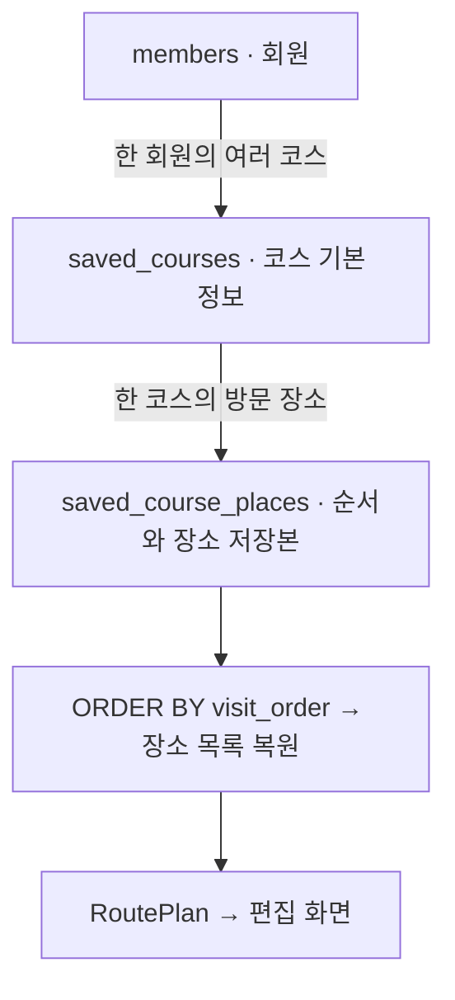

> **최신 안내:** 이 페이지에는 이전 버전 기록이 포함돼요. ea2242b의 저장·조회·공통 UI는 [[현재_구현_흐름|현재 전체 흐름]]과 [[업데이트_내역|업데이트 내역]]을 먼저 확인하세요.

## 이번에 정한 범위

코스를 저장했다가 다시 열었을 때 **방문 순서·인원·전체 범위·장소별 이동 반경·가격**을 그대로 복원하기 위한 설계예요. 기준 코드는 `feature/map-integration`의 `d32bc76`이며, 이 작업에서 확인한 `RoutePlan`·`Place`·`UserSession`은 로컬 `ce1cd24`와 같아요.

**이번 결과물은 설계와 테이블 생성 SQL이에요. 아직 앱에서 저장 버튼을 눌러 DB에 저장할 수 있다는 뜻은 아니에요.** DB-02에서 [[05_회원_DB/SavedCourseRepository|저장 로직]]을 구현했어요. 조회는 DB-03, 화면 연결은 UI-01·UI-02에 남아 있어요.

2026-11-13 이 채팅에서 정한 기준은 다음과 같아요.

- 현재 장소 자료는 주기적으로 갱신하지 않는 스냅샷이에요. 가격도 현재 값을 보관해요.
- 장소 이름·좌표는 원본 자료와 별도로 저장해요. 현재 `Place`로 다시 만들 수 있도록 분류·가격·평점·식별자도 같이 보관해요.
- 처음 저장하면 새 코스를 만들어요. 저장한 코스를 다시 편집해서 저장하면 **같은 코스 ID로 갱신**해요.
- 과제 시연에 필요한 기본 구조로 만들어요. 자동 갱신·공유·버전 이력·추천 조건 전체 보관은 추가하지 않아요.

## 두 테이블로 나누는 이유

회원 한 명이 코스를 여러 개 가질 수 있고, 코스 하나에는 장소가 여러 개 들어가요. 코스 이름·인원 같은 정보와 장소 목록을 나누면 장소 수가 달라도 같은 구조를 쓸 수 있어요.

`snapshot`은 **저장 시점의 복사본**이라는 뜻이에요. 저장 장소를 읽을 때 원본 `data_records`와 다시 합치지 않아요. 원본 장소를 지우거나 다시 적재해도 저장한 코스의 정보는 남아요.

## 코스 기본 정보 · saved_courses

| DB 항목 | 자바에서 가져올 값 | 의미 |
|---|---|---|
| `course_id` | 신규 저장 시 DB가 발급 | 저장 코스를 구분하는 번호. 갱신할 때 유지해요. |
| `member_id` | `UserSession.memberId()` | 로그인한 소유 회원. 화면 입력으로 받지 않아요. |
| `title` | `RoutePlan.title()` | 최대 20자. 현재 편집기처럼 빈 이름도 허용해요. |
| `start_lat`, `start_lng` | `startLat()`, `startLng()` | 출발지 좌표. 현재 모델에는 출발지 이름이 없어 이름 필드는 추가하지 않아요. |
| `people` | `people()` | 1~20명. |
| `radius_m` | `radius()` | 출발지 중심 전체 반경, 200~2000m. |
| `created_at`, `updated_at` | DB 기본값·갱신 | 목록 정렬과 저장 시각 표시용이에요. |

## 방문 장소 · saved_course_places

| DB 항목 | 자바에서 가져올 값 | 의미 |
|---|---|---|
| `course_id` | 소속 코스 ID | 어떤 코스에 들어가는지 나타내요. |
| `visit_order` | `places()` 목록 위치 + 1 | 1, 2, 3… 방문 순서. 조회할 때 반드시 이 값으로 정렬해요. |
| `record_id_snapshot` | `Place.recordId()` | 기존 자료의 레코드 ID. 이동 반경을 다시 연결할 때도 사용해요. |
| `place_id_snapshot` | `placeId()` | 원본 장소 문자열 ID. 레코드 ID와 구분해요. |
| `name_snapshot` | `name()` | 저장 시점 장소 이름. |
| `category_snapshot` | `category()` | 장소 분류. |
| `lat_snapshot`, `lng_snapshot` | `lat()`, `lng()` | 저장 시점 장소 좌표. |
| `unit_price_snapshot` | `price()` | 정수 원 단위의 1인 가격. |
| `rating_snapshot` | `rating()` | 현재 자료의 평점. 0~5. |
| `arrival_radius_m` | `arrivalRadii().get(recordId)` | 이 장소까지 오는 구간의 허용 반경. 기록이 없으면 `NULL`. |

`record_id_snapshot`은 원본 DB로 이동하는 외래키가 아니에요. 같은 코스 안에서 중복을 막고 기존 자바 객체를 복원하기 위해 보관하는 값이에요. 원본 자료가 교체돼도 저장본 ID를 새 자료의 같은 숫자에 자동 연결하면 안 돼요.

이동 반경은 **도착 장소에 붙어 있어요.** 첫 장소는 출발지에서 오는 거리, 두 번째부터는 직전 장소에서 오는 거리에 적용해요. 장소 순서를 바꾸면 그 장소에 붙은 반경을 새 직전 장소와 비교해 다시 검사해요.

`NULL`은 숫자 0이 아니라 ‘반경을 기록하지 않았음’이에요. 조회할 때 `arrivalRadii` 맵에 넣지 않아야 원래 상태가 유지돼요. 전체 범위 검사는 별도로 그대로 적용해요.

## 저장하지 않고 계산할 값

- **총금액:** `RoutePlan.totalCost()`처럼 장소별 1인 가격을 더한 뒤 인원수를 곱해요. `long`으로 계산하고 합계 열은 따로 만들지 않아요.
- **코스 내 장소 수:** 방문 장소 행 수로 계산해요.
- **거리 위반 여부:** 복원한 좌표·전체 반경·장소별 반경으로 `RouteRangeValidator`를 다시 실행해요.
- **지도 줌·후보 목록·조건/선택 패널 상태·도보 경로 응답:** 일시적인 화면 상태이므로 저장하지 않아요.

현재 가격 모델에는 가격 미상과 무료를 구분하는 필드가 없어요. 이번 설계는 원본 0을 그대로 보관할 뿐, 0을 무료로 확정하지 않아요. 구분 모델은 별도 카드 `T-31FAD2F2`에서 다뤄요.

## 장소 3개 예시로 확인하기

코스 101, 회원 7, 이름 ‘주말 코스’, 2명, 전체 반경 1000m라고 생각해 보세요. 아래 이름·가격은 동작 설명을 위한 예시예요.

| 방문 순서 | 레코드 ID | 장소 이름 | 1인 가격 | 이 장소까지의 반경 |
|---|---:|---|---:|---|
| 1 | 11 | 예시 식당 | 10,000원 | 기록 없음 → NULL |
| 2 | 22 | 예시 카페 | 5,000원 | 500m |
| 3 | 33 | 예시 전시관 | 8,000원 | 800m |

복원 결과는 다음과 같아야 해요.

1. 장소 목록은 식당 → 카페 → 전시관 순서예요. 삽입 순서가 달라도 `visit_order`로 읽어요.
2. 반경 맵은 `{22: 500, 33: 800}`이에요. 첫 장소 11에 기본 반경을 만들어 넣지 않아요.
3. 총금액은 `(10,000 + 5,000 + 8,000) × 2 = 46,000원`이에요.
4. 원본 장소 자료를 다시 읽지 않고도 이름·좌표·가격·평점을 복원해요.
5. 같은 코스를 편집해 저장하면 코스 ID 101과 생성 시각은 유지해요.

## DB-02에 구현한 저장 순서

아래 순서는 `SavedCourseRepository`에 구현했어요. 실제 화면 버튼에서 호출하는 연결은 아직 없어요.

1. `UserSession`과 확정된 `RoutePlan`을 받으며, 신규/기존 코스 ID를 별도로 전달해요.
2. 장소 중복·이름 길이·좌표·인원·반경을 검사해요. 목록 밖 장소의 반경 정보가 남아 있다면 정리하거나 거부해요.
3. 하나의 DB 연결에서 트랜잭션을 시작해요.
4. 신규는 코스를 INSERT하고 발급 ID를 받아요. 기존은 `WHERE course_id = ? AND member_id = ?`로 소유자를 확인해 UPDATE해요. 대상이 없으면 신규 코스로 바꾸지 말고 실패 처리해요.
5. 기존 방문 장소를 같은 트랜잭션에서 지우고, 현재 목록을 순서 1부터 다시 넣어요. 빈 코스라면 방문 장소는 0행이에요.
6. 전부 성공하면 COMMIT, 하나라도 실패하면 ROLLBACK해요. 코스 이름만 바뀌거나 장소 일부만 저장되면 안 돼요.
7. 성공한 뒤에만 현재 저장 코스 ID를 화면 쪽에 보관해요. 편집 취소에서는 DB를 건드리지 않아요.

`RoutePlan`에는 코스 ID·회원 ID가 없어요. 편집용 모델은 유지하고, 저장 결과는 DB-02에서 추가한 [[04_데이터/SavedCourse|SavedCourse]]로 묶어요. 화면에서 현재 저장 코스 ID를 기억하는 연결은 UI-01에서 추가해요. 과거 데모의 `Course`는 문자열 ID와 별도 금액 구조를 사용하므로 그대로 저장 모델로 쓰지 않아요.

## DB-03에서 구현할 조회 순서

코스는 `course_id`와 로그인한 `member_id`로 조회해요. 방문 장소는 해당 코스의 행을 `ORDER BY visit_order`로 읽어 `Place` 목록으로 만들고, `NULL`이 아닌 이동 반경만 맵에 넣어요. 코스 기본 정보와 합쳐 `RoutePlan`을 만든 뒤 편집기에 전달해요. 목록도 반드시 `member_id`로 제한해요.

## SQL 실행과 확인 범위

SQL 파일은 저장소의 `data/sql/07_saved_courses.sql`이에요. 사이트에서는 <a href="/downloads/07_saved_courses.sql" download data-router-ignore>테이블 생성 SQL 내려받기</a>로 내용을 확인할 수 있어요. 앱과 같은 MySQL DB를 선택하고 `02_create_tables.sql`로 회원 테이블을 준비한 뒤 실행하는 설계예요. **이번 작업에서 실제 DB에 실행하지 않았어요.**

- 목표 DB는 CHECK 제약을 적용하는 MySQL 8.0.16 이상이에요.
- 같은 코스의 방문 순서와 레코드 ID는 중복될 수 없어요. 코스 이름은 회원 내에서도 중복을 허용해요.
- 빈 장소 목록은 허용해요. 연속된 방문 순서, 범위 안의 장소인지, 소유자 본인인지 등은 저장 서비스에서도 검사해요.
- 코스를 삭제하면 그 코스의 방문 장소도 함께 삭제해요. 소유 코스가 남은 회원의 물리 삭제는 차단하므로, 회원 삭제를 연결할 때 코스 처리도 정해야 해요.
- `CREATE TABLE IF NOT EXISTS`는 없는 테이블만 만들어요. 이미 존재하는 테이블 구조를 새 설계로 바꾸는 명령은 아니에요.

`SavedCourseSchemaTest`는 H2의 MySQL 호환 모드에서 이 SQL을 읽어 3개 장소 복원·기본 제약·빈 코스·삭제 관계를 확인해요. 실제 MySQL에서의 실행이나 앱 저장·재조회가 검증됐다는 뜻은 아니에요.

## 코드를 읽는 순서

1. `RoutePlan`: 코스 전체 상태, 장소 순서, 반경 맵, 합계 계산.
2. `Place`: 장소 한 곳을 복원하는 데 필요한 8개 값.
3. `UserSession`: 저장 소유자 번호.
4. `07_saved_courses.sql`: 두 테이블의 열·관계·기본 조건.
5. `SavedCourseSchemaTest`: 설계 예시가 DB에서 유지되는지 확인하는 코드.

자바의 `record`는 관련 값을 한 묶음으로 전달하는 자료형이에요. `List<Place>`는 순서가 있는 장소 목록이고, `Map<Long, Integer>`는 장소 레코드 번호로 이동 반경을 찾는 표예요. `recordId`와 `placeId`는 서로 다른 값이므로 혼동하지 않는 게 중요해요.
