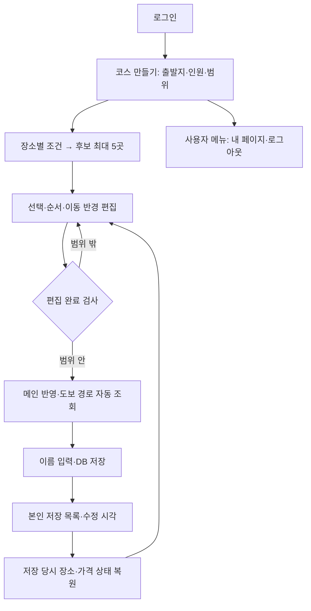

# 현재 구현 흐름

`feature/map-integration`의 **ea2242b** 기준이에요. 이전 기준은 `d32bc76`이에요. 개발 중이므로 최신 커밋과 함께 확인하세요.

- **편집 완료**는 메인 지도 반영, **코스 저장**은 DB 보관이에요. 불러온 코스를 다시 저장하면 같은 ID를 갱신해요.
- 돌아가도 초안·조건·후보 선택은 앱 안에 남아요. 초기화·다른 코스 불러오기·로그아웃에서는 미저장 내용을 확인해요. 앱 종료 후 미저장 초안 복원은 아직 없어요.
- 장소가 있는 코스는 출발지 변경을 막아요. 선·핀 클릭은 구간 선택이며, 팝업을 닫는 빈 지도 클릭에서는 출발지 알림을 띄우지 않아요.
- 가격 미확인을 무료로 계산하지 않아요. `PriceEstimate`가 가격 범위·단위·근거, `CostEstimate`가 인원별 합계와 미확인 수를 다뤄요.
- 기존 DB와 시연 JSON은 `PlaceSource`로 읽어요. 시연 9곳의 가격은 아직 모두 미확인이며 원본 자료를 덮어쓰지 않아요.

## 코드 읽는 순서

| 관심 기능 | 읽을 코드 |
|---|---|
| 전체 화면 | [[02_화면/ConditionController|홈]] → [[02_화면/RouteEditorController|편집]] |
| 저장·다시 열기 | [[05_회원_DB/SavedCourseRepository|저장소]] → [[02_화면/SavedCourseController|목록]] |
| 상속·공통 UI | [[02_화면/BasePageController|공통 부모]] → [[02_화면/MyPageController|내 페이지]] → [[02_화면/PageFeedback|알림]] |
| 가격 | [[04_데이터/PriceEstimate|장소 가격]] → [[04_데이터/CostEstimate|코스 합계]] |
| 지도 | [[02_화면/PlannerMap|Java 지도 연결]] → [[08_지도_보충/map.js|웹 지도]] |

## 확인 범위와 다음 일

Java 자동 검사 **164개**, 장소 자료 Python 검사 **46개**가 통과했어요. 사용자가 실제 저장·수정·앱 재시작 복원을 확인했어요. 이후 추가한 사용자 메뉴·로그아웃 재로그인·Windows 포커스·실제 지도 팝업은 최종 수동 시연으로 확인해야 해요.

**미구현:** 편집 중 이동 시간 자동 누적, 후보 5곳 경로 비교, 자동차·대중교통 계산, 외부 리뷰 프리뷰, 잘못된 장소 정보 제보. 과제 일정상 핵심 흐름 시연을 먼저 확인해요.

실행: [[실행_및_테스트|clone부터 실행하기]] · [[공통_UI와_홈_메뉴|공통 UI]] · [[코스_저장과_다시열기|저장 흐름]] · [[시연_장소와_가격_흐름|시연 자료]]
