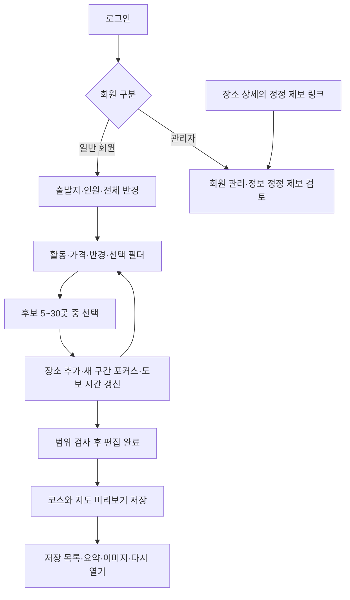

**master 334705d · 2026-11-16 점검**이에요. 사용 순서를 먼저 읽고, 필요한 기능의 코드로 이동하세요.
초기 클래스 노트와 조사 문서는 작성 시점이 다르므로 이 페이지와 [[업데이트_내역|업데이트 내역]]을 먼저 확인해 주세요.

## 사용자가 만나는 흐름

1. **공통 조건:** 출발지·인원·전체 반경을 정해요. 장소가 있는 코스는 출발지를 보호해요. 초기화하면 인원·반경·출발지 선택도 기본값으로 돌아가요.
2. **장소 편집:** ‘내 코스 보기 / 다음 장소의 조건 / 추천 후보’ 중 한 영역을 열어요. 이미 열린 영역은 다른 영역을 열어 전환해요.
3. **조건과 후보:** 활동에 맞는 업종·상세 종류·태그·가격 조건을 선택해요. 후보 표시 수는 5·10·15·20·30곳이고 두 선택 위치가 동기화돼요. 처음에는 ‘후보 검색’, 결과가 있으면 ‘후보 업데이트’예요.
4. **지도:** 빨간 코스 핀은 장소 상세, 경로선과 원형 구간 번호는 경로 안내로 이어져요. hover는 짧게, 클릭은 상세하게 보여줘요. 빈 지도 클릭은 팝업과 장소 카드를 닫아요.
5. **반경과 이동:** 조절 중인 원을 줄이고 놓으면 그 원에 맞춰 확대해요. 장소 추가 직후에는 직전 장소→추가 장소 구간을 보여줘요. 첫 장소는 출발지 기준이에요. ‘두 범위 보기’로 전체 범위를 다시 확인해요.
6. **시간:** 편집 중 장소 구성이 바뀌면 도보 경로를 자동 조회해 구간별 시간과 누적 시간을 표시해요. 반경은 직선거리 조건이므로 실제 도보거리와 달라요.
7. **저장:** 편집 완료는 화면 반영, 코스 저장은 DB 보관이에요. 저장 이미지에는 실제 지도 바탕에 방문 순서를 **직선**으로 연결해요. 도보 선을 이미지에 넣지 않아요.
8. **복구:** 코스 저장은 성공했지만 이미지가 없으면 저장 목록에서 미리보기만 다시 만들어요. 이미지 조회 실패는 다시 불러오기로 구분해요. 코스를 중복 저장할 필요가 없어요.

## 계정과 관리자

`UserContext`가 한 번의 로그인에 대한 프로필·저장 목록을 함께 보관해요. 탭에 들어갈 때마다 같은 목록을 다시 쿼리하지 않고, 변경 후 캐시를 무효화해 갱신해요. 수동 새로고침도 가능해요. 로그아웃하면 계정 캐시와 화면을 비워요.

관리자는 같은 창에서 회원 표와 제보 검토를 사용해요. 회원 상태는 **정상/탈퇴**, DB 값은 ACTIVE/INACTIVE예요. 수정·탈퇴·삭제·제보 승인/반려 전에 확인해요. 저장한 코스가 있는 회원은 영구 삭제를 제한하고 이유를 안내해요. [[관리자_이용과_검토|관리자 안내]]

## 장소 데이터와 신뢰도

앱이 보관하는 공공자료·관리자 정정과 외부 제공자의 일시적인 상세 값을 구분해요. 평점이 없거나 속성을 확인하지 못한 경우 0점·불가능으로 단정하지 않아요. 공공 태그의 근거와 가격 추정도 별도예요.

Google 연결 모델과 검증 도구가 있다고 해서 모든 장소가 Google과 연결됐거나 실시간 평점·영업시간을 보여주는 것은 아니에요. [[장소_데이터와_표시|데이터 모델과 표시 범위]]

## 확인 범위

새 커밋 사본에서 Java 회귀 검사 324개·Python 59개와 JAR 빌드, 최근 변경의 실제 Kakao 카메라 검사 1개가 통과했어요. 문서 사이트는 별도 검사를 유지해요. [[변경_요약|변경 파일·함수 요약]]도 함께 읽어 주세요. 구체적인 범위와 남은 일은 [[최종_검토_2026_11_15|이번 전체 검토]]에 정리했어요.

**아직 제공하지 않는 기능:** 후보 전체의 도보 경로 비교, 자동차·대중교통 경로, 외부 사이트 리뷰 본문 프리뷰, 앱 종료 후 미저장 초안 복원. 별도 예제 화면의 커뮤니티 기능을 실제 운영 기능과 혼동하지 않아요.

실행: [[실행_및_테스트|처음 실행하기]] · [[지도_범위와_포커스|지도 조작]] · [[저장_미리보기와_복구|저장과 이미지]] · [[사용자_안내와_진단|안내와 오류 처리]]
