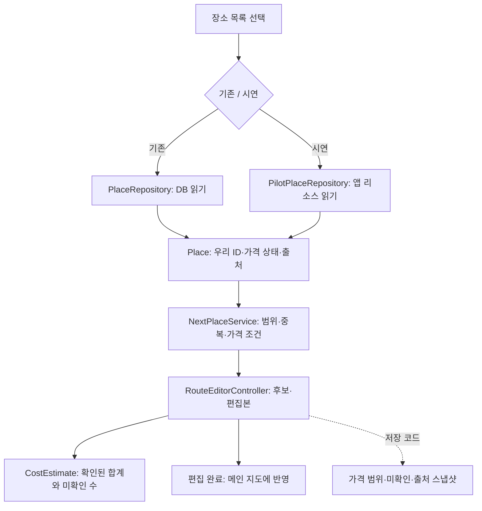

# 시연 목록과 가격 범위 연결

구현일: 2026-11-13. **시연 목록 9곳을 기존 목록과 선택해 사용할 수 있게 연결했다. 가격 미확인은 0원이 아니라 별도 상태로 추천·편집·합계·저장에 전달한다.**

## 실행 확인

프로젝트 최상단에서 실행한다.

```powershell
# 회원 DB 없이 서면·전포 시연 목록으로 시작
.\gradlew.bat runPilotDemo

# 기존 로그인 앱. 로그인 후 왼쪽 '장소 목록'에서 시연 목록 선택 가능
.\gradlew.bat run

# 실제 API/DB 없이 전체 자동 검사
.\gradlew.bat test
```

실제 카카오 지도에는 기존 JavaScript 키·네트워크가 필요하다. 앱이 지도 서버를 자동 시작하므로 별도 서버는 필요하지 않다. Google API를 호출하거나 실제 MySQL에 데이터를 적재하는 기능은 이번 실행 경로에 추가하지 않았다.

1. `runPilotDemo`로 열면 서면역 주변·전체 2km·시연 목록 9곳으로 시작한다.
2. 인원·출발 위치·전체 반경을 확인하고 **코스 만들기**를 누른다.
3. 현재 9곳은 모두 1인 가격 미확인이다. **가격 미확인·상한 미확인 장소도 포함**을 선택한다.
4. 후보 추천 → 추가 → 다른 장소 추가·편집 → **편집 완료**를 확인한다.
5. 후보·내 코스·지도 상세·메인 요약에 `가격 미확인`이 보이는지 확인한다. 미확인만 있는 코스를 `0원`으로 표시하지 않는다.

체크하지 않으면 가격 상한을 증명할 수 없는 장소는 제외한다. 체크해도 알려진 최대금액이 상한을 넘는 장소는 포함하지 않는다. 알려진 하한부터 상한을 넘는 경우도 제외한다. 포함 옵션은 미확인 가격이 상한을 충족한다는 뜻이 아니다.

기존 코스가 있는 상태에서 목록을 바꾸면 코스를 비우는지 확인한다. 다른 목록의 장소를 자동으로 섞지 않는다. 이전 DB 조회가 늦게 끝나더라도 새로 고른 시연 목록을 덮어쓰지 않는다.

## 데이터 흐름



화면의 **편집 완료는 메인 코스에 반영**하는 기능이다. 로그인 앱의 헤더의 **코스 저장**을 누르면 DB에 보관한다. 저장 목록과 수정 저장의 확인 절차는 [코스 저장과 다시 열기](코스_저장과_다시열기.md)를 참고한다. 회원 정보가 없는 `runPilotDemo`에서는 저장·조회를 사용할 수 없다.

## 가격 모델

`PriceEstimate`는 최소·최대·단위·근거 설명을 담는다. 단위는 1인·기준 음료 한 잔·성인 입장권·미확인을 구분한다. 사용자 한 명당 한 잔/입장권 한 장으로 계산하는 구성이다. 단체 세트처럼 1인 기준이 없으면 미확인 단위로 두고 인원수와 곱하지 않는다.

| 상태 | 표현·동작 |
|---|---|
| 1인 10,000~15,000원 | 2명일 때 20,000~30,000원 |
| 금액 없음 | 가격 미확인. 합계에 0원으로 포함하지 않음 |
| 근거 있는 0~0원 | 확인된 무료로 계산 가능 |
| 최대 없음 | 하한 이상으로 표시. 유한한 상한을 만들지 않음 |
| 단위 미확인 | 인당 비용과 가격 상한 충족 여부 미확인 |

위 숫자는 설명용이며 시연 장소에 실제로 입력한 금액이 아니다. 현 시연 9곳은 모두 미확인이다.

예: 설명용 식사 1인 10,000~15,000원 + 음료 4,000~6,000원, 2명 → 28,000~42,000원. 다른 한 곳이 미확인이면 **확인된 비용 28,000원~42,000원 + 가격 미확인 1곳**으로 표시한다.

기존 DB JSON의 0·null·가격 누락은 무료 근거가 없으므로 미확인으로 읽는다. 기존 데모가 명시적으로 `new Place(..., int price, ...)`를 만드는 생성자는 정확한 1인 가격을 제공하는 호환 경로다. 입력 자료 로더는 미확인 상태를 명시적으로 사용한다.

## 코드 읽는 순서와 핵심 메서드

| 순서 | 파일 | 핵심 메서드·역할 |
|---|---|---|
| 1 | [PriceEstimate](../src/main/java/com/datecourse/model/PriceEstimate.java) | `withinCap`, `display`: 상한 판단·가격 표시 |
| 2 | [CostEstimate](../src/main/java/com/datecourse/model/CostEstimate.java) | `of`, `display`: 확인된 금액만 계산하고 미확인 수 표시 |
| 3 | [Place](../src/main/java/com/datecourse/model/Place.java), [PlaceDetails](../src/main/java/com/datecourse/model/PlaceDetails.java) | 자체 ID·가격·기본 정보·출처·외부 ID |
| 4 | [PilotPlaceRepository](../src/main/java/com/datecourse/service/PilotPlaceRepository.java) | `findAll`, `read`: 시연 리소스 검증·읽기 |
| 5 | [ConditionController](../src/main/java/com/datecourse/controller/ConditionController.java) | `changeSource`, `loadPlaces`: 목록 전환·이전 비동기 결과 무효화 |
| 6 | [NextPlaceService](../src/main/java/com/datecourse/service/NextPlaceService.java) | `candidates`: 기존 두 반경·중복 검사와 가격 불확실 옵션 |
| 7 | [RouteEditorController](../src/main/java/com/datecourse/controller/RouteEditorController.java) | `onRecommendNext`, `refreshSummary`: 후보와 비용 표시 |
| 8 | [SavedCourseRepository](../src/main/java/kr/ac/university/localdb/db/SavedCourseRepository.java) | `replacePlaces`, `readPlaceSnapshot`: 새 가격 상태·출처 보존 |

`PlaceSource`는 `findAll()`을 제공하는 인터페이스다. 화면은 DB와 파일 중 무엇을 읽는지와 관계없이 같은 장소 목록을 받는다.

`Integer`는 숫자와 `null`을 구분할 수 있는 자바 타입이다. 이번 가격 모델에서 `null`은 ‘모름’이다. `record`는 전달할 데이터를 묶고, `List.copyOf`·`Map.copyOf`는 화면 사이에서 원본을 실수로 바꾸지 못하게 한다. 예전 `price()`·`totalCost()`는 정확한 금액이 있을 때만 사용할 수 있고, 범위·미확인에는 예외를 내어 0원으로 숨기지 않는다. 현재 편집 흐름은 새 모델을 사용한다.

## 저장 구조 변경

`07_saved_courses.sql`은 유지하고 [08_saved_course_price_estimates.sql](../data/sql/08_saved_course_price_estimates.sql)을 추가했다. **실제 DB에는 실행하지 않았다.**

- `unit_price_snapshot`을 NULL 가능으로 변경. 정확한 인당 값이 있을 때만 숫자 저장.
- `price_estimate_snapshot`: 최소·최대·단위·근거를 JSON 문자열로 보존.
- `place_details_snapshot`: 공개 원본의 출처·기준일·기본 정보·외부 ID 보존.
- 과거 가격 0원이고 새 스냅샷이 없는 행은 근거 불명으로 미확인 처리.

저장 코드 사용 전, 선택한 개발 DB에서 07이 적용된 상태로 08을 **한 번** 실행해야 한다. 기존 행은 지우지 않는다. 이미 컬럼을 추가한 DB에 반복 실행하는 SQL은 아니다. 구버전 07만 있는 DB에서 새 저장 코드를 호출하면 추가 컬럼이 없어 실패한다. 화면 저장 연결을 구현할 때 이 준비 여부를 함께 확인해야 한다.

H2 메모리 DB에서 미확인·범위·명시적 무료·출처의 저장/복원, 이전 행 보존, 기존 트랜잭션 롤백 검사를 수행했다. 실제 MySQL·Aiven 동작을 검증한 것은 아니다.

## 확인 범위

자동 검사는 가격 범위·상한·미확인·무료 구분, 포장된 시연 자료, 기존 DB 가격 누락 처리, 늦은 DB 조회 무시, 후보 추가부터 메인 반영, 지도 상세의 안전한 텍스트 표시, 저장 스냅샷 복원을 포함한다.

실제 카카오 검색 결과·도보 경로 품질과 장소 현장 영업·가격은 별도다. 9곳은 장소 동일성 검증의 작은 시연 목록이지, 가격과 운영을 모두 보증한 완성 데이터셋이 아니다.
