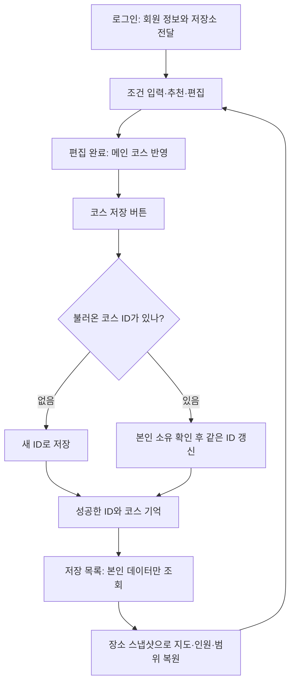

# 코스 저장 → 다시 열기 → 수정 저장

구현일: 2026-11-13. 현재 작업 폴더 기준이며 아직 커밋·배포한 내용은 아니다.

## 실행과 확인

회원 DB 접속 설정과 카카오 지도 키를 준비한 뒤 프로젝트 최상단에서 실행한다.

```powershell
.\gradlew.bat run
```

DB에는 기존 회원 테이블과 `data/sql/07_saved_courses.sql`, `08_saved_course_price_estimates.sql`이 필요하다. **08은 07 이후 한 번만 실행하는 변경 SQL**이다. 이미 적용된 DB에는 다시 실행하지 않는다. 이번 작업에서 실제 DB에 SQL을 실행하지 않았다.

1. 로그인하고 코스를 만든다. **편집 완료**는 메인 지도에 반영하는 동작이다.
2. 헤더의 **코스 저장**을 누르고 이름을 입력한다. 성공 안내가 나와야 DB 저장이 끝난 것이다.
3. 헤더의 **저장한 코스**에서 목록과 장소 순서·인원·가격 상태를 확인한다. 같은 창 안에서 전환한다.
4. **이 코스 불러오기**로 메인 지도에 복원한다. 저장하지 않은 코스가 있으면 교체 여부를 확인한다.
5. 편집 후 다시 **코스 저장**한다. 기존 코스 하나를 갱신하며 목록에 새 항목을 추가하지 않는다.
6. 새 항목을 만들려면 **새 코스**를 누른다. 다음 저장은 새로운 ID로 저장한다.
7. 앱을 종료하고 같은 회원으로 로그인한 뒤 목록에서 다시 불러본다.

`runPilotDemo`는 회원 DB 없이 여는 화면이므로 저장·조회 버튼을 누르면 로그인 안내를 보여준다. 저장 검증에는 로그인 앱을 사용한다. 로그인 앱에서도 서면·전포 시연 목록을 선택할 수 있다.

목록의 이름 변경·삭제도 실제 DB에 반영한다. 삭제는 확인 창을 거치며 해당 코스의 장소 스냅샷도 함께 삭제한다. 저장·조회 실패 시 현재 메인 코스는 유지한다. 테이블 미준비·DB 연결 실패는 화면 안내 후 재시도할 수 있다.

## 동작 흐름



현재 장소 원본을 다시 검색해 복원하지 않는다. 저장 당시 이름·좌표·방문 순서·가격 범위·가격 미확인·출처·장소별 이동 반경을 읽는다. 원본 장소 자료가 바뀌어도 저장한 장소를 임의로 바꾸지 않는다. 추가 후보는 현재 선택한 장소 목록을 사용한다.

## 코드 읽는 순서

| 순서 | 파일 | 먼저 볼 메서드 |
|---|---|---|
| 1 | `src/main/java/kr/ac/university/localdb/ui/MembershipApp.java` | `loadConditionScreen`: 로그인 회원과 공용 DB 풀을 사용하는 저장소 전달 |
| 2 | `src/main/java/com/datecourse/controller/ConditionController.java` | `onSaveCourse`: 화면의 인원·범위와 확정 장소를 모아 저장. 성공 후에만 ID 기억 |
| 3 | 같은 파일 | `onSavedCourses`, `restoreSavedCourse`: 목록 열기와 저장한 코스 복원. `onNewCourse`는 저장 ID 초기화 |
| 4 | `src/main/java/com/datecourse/controller/SavedCourseController.java` | `configure`, `onRefreshClick`, `onOpenClick`: 실제 DB 목록·상세·불러오기 연결 |
| 5 | `src/main/java/kr/ac/university/localdb/db/SavedCourseRepository.java` | `save`, `persist`, `findAll`, `readPlaceSnapshot`: 저장·갱신·회원별 조회·장소 복원 |

`Long savedCourseId`의 `null`은 아직 저장한 항목이 없다는 뜻이다. 새 저장에 성공하면 DB가 발급한 번호를 기억한다. 기존 코스를 불러와도 그 번호를 유지하기 때문에 다음 저장에서 덮어쓸 대상을 알 수 있다.

`Task<T>`의 `call()`은 DB 작업을 별도 스레드에서 실행한다. `setOnSucceeded`와 `setOnFailed`는 JavaFX 화면 스레드에서 버튼·안내를 갱신한다. DB 처리 동안 중복 저장과 메인 편집을 막는다.

`findAll()`의 `LEFT JOIN`은 장소가 없는 예전 저장 코스도 목록에 남긴다. `ORDER BY`는 최근 수정 코스부터, 코스 안에서는 방문 순서대로 읽게 한다. SQL의 `member_id=?`는 로그인 회원의 코스만 조회·변경하도록 제한한다.

## 자동 검증과 남은 확인

- H2 테스트 DB: 회원 구분, 빈 코스, 방문 순서, 가격·출처 복원, 같은 ID 갱신, 이름 변경, 삭제 연쇄 처리.
- 실제 FXML 컨트롤러 + H2: 저장 → 목록 → 불러오기 → 인원 수정·같은 ID 저장 → 새 코스 저장 → DB 실패 시 현재 코스 보존.
- 실제 MySQL 접속, 기존 DB의 07·08 적용 상태, 로그인 앱을 종료한 뒤 다시 여는 수동 시연은 별도 확인해야 한다. 자동 검사는 실제 DB를 변경하지 않는다.

```powershell
.\gradlew.bat test
```
